# CH01 统计学习及监督学习概论


[TOC]

## 前言

**统计机器学习**是关于计算机<span style='color:red'>1)基于数据构建概率统计模型，并2)运用该模型对数据进行分析与预测的一门学科</span>。

统计机器学习是概率论、统计学、信息论、计算理论、最优化理论即计算机科学等多个领域的交叉学科。

机器学习：T(Task)-E(Experence)-P(Performance)

研究对象是数据：从数据出发，提取数据特征，抽象数据模型，发现数据中的知识，又回到数据分析与预测中去。<span style='color:red'>从数据中来，到数据中去</span>。

<span style='color:red'>基本假设前提：同类数据具有一定的统计规律性</span>。从而可以使用概率统计方法处理它们：用随机变量描述数据中特征，用概率分布描述数据的统计规律。

**数据分类**

- 离散变量
- 连续变量

**目的**

用于数据的分析与预测，这是通过构建概率统计模型实现的。总的目标：就是考虑学习什么样的模型和如何学习模型，以使模型能够对数据进行准确的分析和预测。

前言部分从各个维度讲解了统计机器学习是什么，最后有个系统的工作概括总结：
统计学习方法可以概括如下：从给定的、有限的、用于学习的训练数据（training data）集合出发，假设数据是独立同分布产生的；并且假设要学习的模型属于某个函数的集合，称为假设空间（hypothesis space）；应用某个评价准则（evaluation criterion），从假设空间中选取一个最优模型，使它对已知的训练数据及未知的测试数据（test data）在给定的评价准则下有最优的预测；最优模型的选取由算法实现。这样，统计学习方法包括模型的假设空间、模型选择的准则以及模型学习的算法</span>。称其为<span style='color:red'>统计学习方法的三要素，简称为模型（model）、策略（strategy）和算法（algorithm）</span>。

四要素：数据、模型、策略和算法

### 导读

- 第二版重新梳理了这部分目录结构，舒服多了，尤其之前的分类，回归与标注因为出现了1.10造成目录中这部分不对齐，非常不爽。结果，第二版改了。赞
- 本章最后的三个部分，这三个问题可以对比着看，如果暂时没有概念，略过也可以，回头对各个算法有了感觉回头再看这里。

  这三部分怎么对比，三部分都有个图来说明，仔细看下差异，本文后面会对此展开。
- 关于损失函数，风险函数与目标函数注意体会差异
- 后面插点从深度学习角度拿到的点

    - 关于机器学习三要素, 复旦大学邱锡鹏教授也有解读[^2]: 模型, 学习准则, 优化算法. 这个定义比较接近代码. 以Tensorflow为例. 通常会定义一个网络(模型), 定义Loss(学习准则), 定义优化算法(Optimizer), 然后开Session, 不停的把数据带入用Opitmizer去最小化Loss.
    - Losses, Metrics, 在Keras里面划分了两个模块, 解释是Losses是BP过程用到的, 而Metrics实际和损失函数类似, 用来评价模型的性能, 但是不参与反向传播. 从源码也能看到, Metrics里面import了很多Loss算法
- 书中例子1.1可以参考PRML中对应的表述，更详细些。
- 在监督学习中输入和输出对称为**样本**，在无监督学习中输入是**样本**。
- 注意在介绍输入空间，输出空间等概念的时候，以及这一章的很多部分都会有个帽子，`监督学习中`， 书中也明确了`本书主要讨论监督学习的问题`，最后的概要总结部分对监督学习有这样的描述：`监督学习可以概括如下：从给定有限的训练数据出发，假设数据是独立同分布的，而且假设模型属于某个假设空间，应用某一评价准则，从假设空间中选取一个最优的模型，使它对已给的训练数据以及未知测试数据在给定评价标准意义下有最准确的预测。`，理解下这里的假设。
- 在贝叶斯学习部分，提到`将模型、观测要素及其参数用变量表示，使用模型的先验分布是贝叶斯学习的特点。`注意这里面先验是**模型**的先验分布。
- 在泛化误差部分，用了$\hat f$表示最优估计，这个有时候也会用$f^*$表示意思差不多。有时候表示向量又要表示估计值，用$*$可能好看一点，比如$\vec x^*$，但是通常每本书都有自己的符号体系，向量可以通过字体表示，具体可以从书中的符号表部分了解。关于这一点，在第二版第一章就有所体现，监督和无监督学习中，模型用 hat 表示，在强化学习中，最优解用*表示。
- 提一下参考文献，几个大部头都在，ESL，PRML，DL，PGM，西瓜书，还有Sutton的强化学习，不过这本书2018年出了第二版，感兴趣的话可以看新版。

## <span style='color:red'>实现统计学习方法的步骤</span>

统计学习方法三要素：模型，策略，算法
1. 得到一个有限的训练**数据集合**
2. 确定包含所有可能的模型的**假设空间**，即学习模型的集合
3. 确定模型选择的准则，即学习的**策略**
4. 实现求解最优模型的算法，即学习的**算法**
5. 通过学习方法选择最优的模型
6. 利用学习的最优模型对新数据进行预测或分析

## 统计学习分类
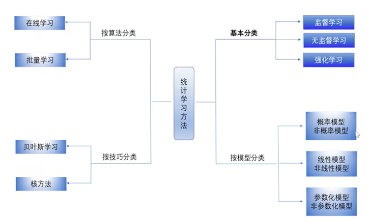

### 基本分类
#### 1. 监督学习

应用：
1. 分类
2. 标注
   1. Q:这里的标注是指的什么是不是也属于分类的一种，哦是不是就类似一句话的词性标注？
   2. A: 序列标注是分类的一种结构化扩展，但不完全等同于普通分类

3. 回归

从标注数据中学习，`<输入,输出>` 对，本质是学习输入到输出的映射 $f(x)$ 或 $P(x,y)$

**输入空间 vs 输出空间**
- 可以是有限元素，也可以是无限元素空间，如欧式空间
- 输入和输出空间可以是同一个空间，也可以不是

**实例（样本）**
- 由特征向量表示，所有特征向量存在的空间成为特征空间
- 包含输入与输出

**特征空间**
- 每个具体的输入通常由特征向量表述，所有特征向量存在的空间
- 一般输入空间和特征空间是一样的，在svm等中通过核技巧变换后的特征空间和输入空间则是不同的
  - 例如：核技巧
    输入空间：$\mathbf{R}^2$；实例：$x = (x^{(1)}, x^{(2)})^T$

    $\phi(x): \mathbf{R}^2 \to \mathcal{H}$；$\phi(x) = ((x^{(1)})^2, \sqrt{2}x^{(1)}x^{(2)}, (x^{(2)})^2)^T$

##### 联合概率分布
监督学习假设输入与输出的随机变量 $X$ 和 $Y$ 遵循联合概率分布 $P(X,Y)$。在学习中假设这一联合概率分布存在，但对具体的定义是未知的。

训练数据和测试数据被看做是依联合概率分布 $P(x,y)$ 独立同分布产生的。

---
##### 都看做概率的话，如何适用于回归场景？
claude:

在监督学习中，我们假设输入变量 $X$ 和输出变量 $Y$ 遵循某个联合概率分布 $P(X, Y)$。对于回归场景，这意味着：

1. 联合分布假设：
存在一个真实的联合概率分布 $P(X, Y)$，它描述了输入 $X$         和对应输出 $Y$ 同时出现的概率。在回归问题中，$Y$ 是连续值（如房价、温度、销售额等）。
2. 数据生成过程：
我们观察到的训练数据 ${(x_1, y_1), (x_2, y_2), ..., (x_n, y_n)}$ 是从 $P(X, Y)$ 中独立同分布(i.i.d.)采样得到的。每个样本 $(x_i, y_i)$ 都反映了真实联合分布的一个实例。
1. 条件分布：
在回归中，给定一个输入 $x$，输出 $y$ 服从条件分布 $P(Y|X=x)$。这表示对于相同的输入 $x$，可能有不同的输出 $y$（因为现实世界存在噪声和不确定性）。我们的目标是学习这个条件分布或其期望值。
1. 回归目标：
  - 理论上，最优的回归函数是条件期望：$f^*(x) = \mathbb{E}[Y|X=x]$
  - 这个函数最小化均方误差：$\min_f \mathbb{E}_{(X,Y) \sim
P}[(Y - f(X))^2]$
  - <span style='color:red'>所以回归的本质是估计 $P(Y|X)$ 的均值函数</span>
1. 具体应用：
  - 线性回归：假设 $Y = w^T x + \epsilon$，其中 $\epsilon
\sim N(0, \sigma^2)$，即 $P(Y|X=x)$ 是高斯分布
  - 非参数回归：直接估计 $P(Y|X)$ 而不假设特定形式
    - 不预先设定回归函数的具体数学形式，而是让数据自身决定模型的形状
  - 贝叶斯回归：建模 $P(Y|X)$ 的完整后验分布，不仅预测点估计还给出不确定性量化

例如，在房价预测中，$(X, Y)$ 可能代表房屋特征（面积、位置、房龄等）和价格。联合分布 $P(X,
Y)$ 捕获了这些特征如何影响价格的统计关系，包括内在规律和噪声。

##### 非参数回归：直接估计 $P(Y|X)$ 而不假设特定形式 是什么意思？和参数回归的区别
不预先设定回归函数的具体数学形式，而是让数据自身决定模型的形状。

**具体含义**
- 参数方法对比                                                 
  - 参数回归（如线性回归）：
     - 预设函数形式：$f(x) = w_0 + w_1 x_1 + ... + w_d x_d$
     - 只需估计参数 $w$
     - 模型复杂度固定
- 非参数方法特点
  - 无预设函数形式：不假设 $f(x)$ 是线性、多项式或其他解析表达式
  - 数据驱动结构：模型形状完全由训练数据决定
  - <span style='color:red'>无限维参数空间：理论上需要估计整个函数空间</span>

**典型例子**

- 核回归（Kernel Regression）

$$\hat{y}(x_0) = \sum_{i=1}^n K_\lambda(x_0, x_i) y_i \big/
\sum_{i=1}^n K_\lambda(x_0, x_i)$$

其中 $K_\lambda$ 是核函数（如高斯核），对每个测试点 $x_0$ 都加权组合附近的训练样本。

- 局部多项式回归

在每个点 $x_0$ 附近拟合低阶多项式：
$$\hat{f}(x_0) = \arg\min_{\beta_0, \beta_1} \sum_{i=1}^n
K_\lambda(x_0, x_i)[y_i - \beta_0 - \beta_1(x_i-x_0)]^2$$

**实际效果**
- 真实函数 f(x): sin(x) + 0.1*sin(10x)
- 线性回归:       y = ax + b          # 强制为直线
- 非参数回归:     根据数据形状弯曲    # 自适应曲线

**优缺点**
```
┌────────────┬──────────┬────────────┐
│    特点     │ 参数方法  │ 非参数方法   │
├────────────┼──────────┼────────────┤
│ 模型灵活性   │ 固定      │ 高         │
├────────────┼──────────┼────────────┤
│ 数据需求    │ 少        │ 多         │
├────────────┼──────────┼────────────┤
│ 过拟合风险   │ 低       │ 高         │
├────────────┼──────────┼────────────┤
│ 计算复杂度   │ 低       │ 高         │
└────────────┴──────────┴────────────┘
```

<span style='color:red'>非参数方法的核心优势是能捕捉复杂的非线性模式，但代价是需要更多数据和计算资源</span>

---
##### 假设空间
监督学习的目的在于学习一个由 X -> Y 的映射，这个映射就是模型。模型不是唯一的，这些模型组成的集合叫做假设空间。

监督学习的模型可以是**概率模型 $P(Y|X)$ 或者非概率模型**即决策函数 $Y = f(X)$(本质可以使用概率模型，回归的本质是条件概率的期望函数)

P(X,Y) 表示分布函数或分布密度函数

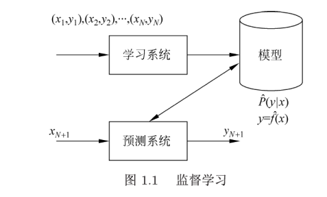

#### 2. 无监督学习
从无标注的数据中学习预测模型即学习到数据的类别、转换或概率。

本质是学习数据中的**统计规律和潜在的结构**
- 聚类
- 降维
- 概率估计

概念：
- 输入空间 $\mathcal{X}$ 
- 隐式结构空间 $\mathcal{Z}$

要学习的模型 $z = g(x)$，条件概率分布 $P(z|x)$，或者条件概率分布 $P(x|z)$ 的形式

因为无监督学习，本质是研究数据中的潜在结构内容，也就是需要学习隐含在数据结构内部的信息，所以无监督学习对应的不是输出空间，而是隐式结构空间。

和监督学习类似，包含所有可能的模型的集合称为假设空间

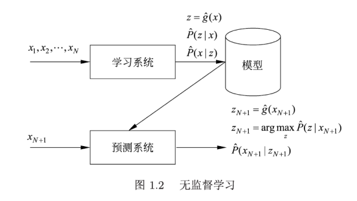

#### 3. 强化学习
指的是智能系统在与环境的连续**互动**中学习最优行为策略的机器学习问题

本质是学习最优的序贯决策

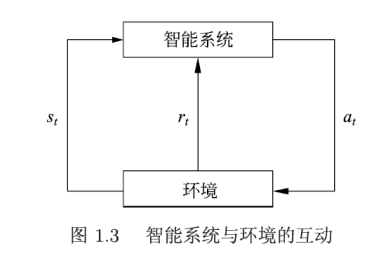

- 在每一步t，智能系统从环境中观测到一个状态（state） $s_t$ 与一个奖励（reward） $r_t$ ，采取一个动作（action）$a_t$。环境根据智能系统选择的动作，决定下一步 t+1 的状态 $s_{t+1}$ 与奖励 $r_{t+1}$。
- 要学习的策略表示为给定的状态下采取的动作
- 目标是长期累计奖励的最大化
- 系统通过不断地试错以达到学习最优策略的目的

#### 4. 其他
1. 半监督学习：
   1. 利用部分标注数据和未标注数据学习预测模型的机器学习问题，通常少量标注，大量未标注
   2. 旨在利用未标注数据中的信息，辅助标注数据，进行监督学习，以较低的成本达到较好的学习效果
2. 主动学习
   1. 机器不断给出实例让教师进行标注，然后利用标注数据学习预测模型

### 按模型分类

#### <span style='color:red'>概率模型与非概率模型</span>

统计学习的模型可以分为概率模型和**非概率模型（或叫确定性模型）**，以监督学习为例
- 概率模型：P(x,y)、P(y|x)、P(x|y)
  - 决策树、朴素贝叶斯、隐马尔可夫模型、条件随机场...
- 非概率模型：y = f(x)
  - 感知机、svm、k紧邻、AdaBoost、k均值、潜在语义分析、神经网络

---

##### 线性回归属于概率模型还是非概率模型
线性回归可以同时视为概率模型和算法模型，这取决于建模的角度：

*概率模型视角（Probabilistic）*                                

当我们将线性回归建立在概率框架下时：                         
1. 数据生成假设：
$$
y = w^T x + \epsilon, \quad \epsilon \sim N(0, \sigma^2)
$$
即 $y|x \sim N(w^T x, \sigma^2)$
1. 似然函数：
$$
P(y|x,w,\sigma^2) = \prod_{i=1}^n
\frac{1}{\sqrt{2\pi\sigma^2}}\exp\left(-\frac{(y_i -
w^Tx_i)^2}{2\sigma^2}\right)
$$
1. 最大似然估计：
最大化似然等价于最小二乘法：
$$
\arg\max_w \mathcal{L} \equiv \arg\min_w \sum_{i=1}^n (y_i -
w^Tx_i)^2
$$

*算法模型视角（Algorithmic）*

纯粹从优化角度：
$$
\min_w |y - Xw|^2
$$
只关注损失最小化，**不涉及概率分布假设**。

*总结*

传统教科书中的线性回归通常采用概率模型框架，因为：
- 提供了参数估计的理论依据（MLE/Bayes）
- 给出预测不确定性量化
- 推导出正则化项的概率解释

所以严格来说，标准线性回归是概率模型，但也可以简化为纯算法模型使用。

---

> claude
生成模型(Generative Models)是一类能够学习数据分布并生成新样本的模型。它们通过学习训练数据的联合概率分布 P(X,Y) 或 P(X) 来工作，因此可以用来生成新的、类似训练数据的样本。这些模型被称为"生成"模型，是<span style='color:red'>因为它们具有生成新数据样本的能力。给定一个随机噪声输入，模型可以生成一个新的、看起来真实的数据样本</span>。

而概率模型是一个更宽泛的概念，它指的是使用概率论来建模和推理的任何模型。概率模型可以是：
- 生成模型（能建模数据的完整分布，可生成新样本）
- 判别模型（只关注条件概率 P(Y|X)，用于分类或回归）

以无监督学习为例
- 概率模型：P(z|x)或P(x|z)
- 非概率模型: z = f(x)

---
"判别模型（discriminative model）这个术语来源于模型的功能，而非建模方式本身：

*术语来源*
"判别"（Discriminate） = 区分/分类不同类别
- 早期机器学习主要解决分类问题
- 模型的任务是区分不同类别的边界
- "判别"比"非概率"更准确地描述了模型作用

*历史背景*

在有监督学习发展初期，出现了两种建模范式：
```
生成模型（Generative）: P(X,Y) = P(Y)·P(X|Y)
      ↓
直接建模数据联合分布
      ↓
可用于生成新样本

判别模型（Discriminative）: 直接建模 P(Y|X) 或决策边界
      ↓
仅用于分类/回归决策
```

*技术对比*
```
  ┌──────────┬──────────────────┬────────────────────────┐
  │   角度   │     生成模型       │        判别模型          │
  ├──────────┼──────────────────┼────────────────────────┤
  │ 学习目标  │ P(X,Y)           │ P(Y|X) 或 f(X)→Y        │
  ├──────────┼──────────────────┼────────────────────────┤
  │ 功能      │ 生成数据 + 分类    │ 仅分类/预测              │
  ├──────────┼──────────────────┼────────────────────────┤
  │ 代表性    │ Naive Bayes, HMM │ SVM, Linear Regression │
  ├──────────┼──────────────────┼────────────────────────┤
  │ 英文术语   │ Generative      │ Discriminative         │
  └──────────┴──────────────────┴────────────────────────┘
```

*现代扩展*
<span style='color:red'>虽然"判别"最初指分类，但现在泛指</span>：
- 直接建模输入到输出的映射
- 不建模输入特征的分布
- 专注于决策边界

所以"判别模型"是历史沿用的术语，现代意义等同于"非生成模型"。

---
概率模型和非概率模型并非一定对应生成模型和判别模型，只是一般情况下如此。

---
#### <span style='color:red'>概率模型和非概率模型以及生成模型和判别模型，这两组之间是什么关系</span>

在机器学习领域，概率模型与非概率模型、生成模型与判别模型是两组不同的概念，但它们之间存在交集，并不互斥。

**概率模型 vs 非概率模型：**
- 概率模型：试图对数据的概率分布进行建模。它可以分为两种情况：
    i. 直接建模联合概率分布 $P(X, Y)$（其中 $X$ 是输入特征，$Y$ 是输出标签），例如朴素贝叶斯。
    ii. 建模后验概率 $P(Y|X)$ 或 $P(X|Y)$。这类模型通常能提供预测结果的置信度。
- 非概率模型：不直接对概率分布进行建模，而是直接学习从输入 $X$ 到输出 $Y$ 的映射函数 $f(X)$。例如感知机、支持向量机（SVM）等。它们直接输出分类结果或回归值，而不提供概率解释。

**生成模型 vs 判别模型：**

- 生成模型：对数据的联合概率分布 $P(X, Y)$ 进行建模（或者等价地，建模 $P(X|Y)$ 和先验 $P(Y)$）。它学习了数据是如何产生的，可以用来生成新的样本点。典型的例子包括隐马尔可夫模型（HMM）、朴素贝叶斯、生成对抗网络（GAN）等。

- 判别模型：直接对条件概率 $P(Y|X)$ 进行建模，或者直接学习一个决策边界/映射函数 $f(X)$ 来区分不同的类别。它关注的是给定输入 $X$，如何预测输出 $Y$，而不需要了解数据的整体分布。逻辑回归、决策树、神经网络等通常是判别模型。

**关系总结：**

1. <span style='color:red'>分类角度不同：第一组（概率/非概率）关注的是模型是否使用概率框架；第二组（生成/判别）关注的是模型的目标是学习联合分布还是条件分布/决策边界</span>。
2. 存在交集：
 - 大部分生成模型都是概率模型，因为它们显式地建模联合概率 $P(X, Y)$。例如，朴素贝叶斯既是生成模型也是概率模型。
 - 大部分判别模型也是概率模型，因为它们建模的是条件概率 $P(Y|X)$。例如，逻辑回归是判别模型也是概率模型。
 - 非概率模型通常是判别模型。因为它们不涉及概率分布的建模，而是直接学习输入到输出的映射，例如 SVM 和感知机。

总的来说，<span style='color:red'>概率性是一个关于模型表达方式的属性，而生成性/判别性是一个关于模型任务目标的属性。</span>一个模型可以同时是概率的和生成的，也可以是概率的和判别的，或者是非概率的和判别的。

| 模型类型 | 概率模型 | 非概率模型 |
|----------|----------|------------|
| **生成模型** | 朴素贝叶斯 | （较少见，理论上有） |
| **判别模型** | 逻辑回归 | 支持向量机 (SVM)、感知机 |

---

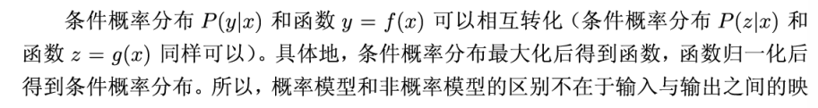
图片中前两句话的理解：<span style='color:red'>在机器学习中，确定性模型（函数）和概率性模型（条件概率分布）本质上是可以互相转换的，它们不是截然对立的，而是同一事物的不同表现形式。</span>

下面我们逐句拆解并通俗解释：

✅ **第一句：“条件概率分布 $ P(y|x) $ 和函数 $ y = f(x) $ 可以相互转化”**

- **含义**：
  - 一个“函数” $ y = f(x) $ 是确定性的：给定输入 $ x $，输出唯一确定的 $ y $。
  - 一个“条件概率分布” $ P(y|x) $ 是概率性的：给定输入 $ x $，输出 $ y $ 是一个随机变量，其取值服从某个概率分布。
  - 但二者可以“互相转化”，意味着我们可以从概率模型导出确定性模型，也可以反过来给确定性模型赋予概率解释。

- **举例**：
  - 假设我们有一个分类器，输出的是每个类别的概率：$ P(y=1|x), P(y=0|x) $ —— 这是概率模型。
  - 如果我们选择概率最大的那个类别作为预测结果：$ \hat{y} = \arg\max_y P(y|x) $，这就变成了一个确定性函数 $ y = f(x) $。
  - 反过来，如果我们有一个函数 $ y = f(x) $，比如回归模型输出连续值，我们可以通过添加噪声或假设误差服从高斯分布，把它变成概率模型：$ P(y|x) = \mathcal{N}(f(x), \sigma^2) $。

---

✅ **第二句：“具体地，条件概率分布最大化后得到函数，函数归一化后得到条件概率分布。”**

这句话是对上一句的具体说明：

🔹 **“条件概率分布最大化后得到函数”**

- 指的是：当我们有一个条件概率分布 $ P(y|x) $，我们可以通过“最大后验估计”（MAP）或“最大似然估计”（MLE）的方式，选出最可能的输出 $ y $，从而得到一个确定性函数：
  
  $$
  f(x) = \arg\max_y P(y|x)
  $$

- 例如，在图像分类中，神经网络输出每个类别的概率，我们选概率最高的那个类别作为最终预测——这就是“最大化”得到函数。

🔹 **“函数归一化后得到条件概率分布”**

- 指的是：如果我们有一个分类函数 $ f(x) $，它可能输出任意实数值（比如 logits），我们可以通过“softmax”等归一化操作，将其转化为一个合法的概率分布：

  $$
  P(y|x) = \frac{\exp(f_y(x))}{\sum_{y'} \exp(f_{y'}(x))}
  $$

- 这样，原本只是一个打分函数 $ f(x) $，现在变成了满足概率公理（非负、和为1）的条件概率分布。

---

📌 **总结理解：**

| 视角 | 函数 $ y = f(x) $ | 条件概率 $ P(y\|x) $ |
|------|-----------|---------|
| 本质 | 确定性映射  | 随机性描述  |
| 转化方式 | 归一化 → 概率分布   | 最大化 → 确定性函数    |
| 实际应用 | 如 softmax 前的 logits | 如分类器的输出概率 |

👉 所以，作者想表达的是：**<span style='color:red'>不要 rigidly 区分“概率模型”和“非概率模型”，它们在数学上是相通的，只是看待问题的角度不同。</span>** 很多现代深度学习模型（如神经网络）其实既是函数又是概率模型，取决于你怎么使用它。

---

概率模型的代表是概率图模型；无论模型如何复杂，均可以用最基本的加法规则和乘法规则进行概率推理。
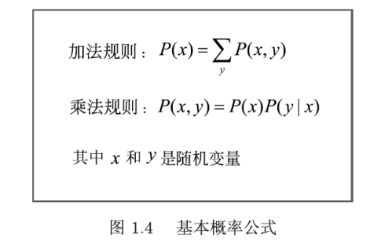

#### 线性模型和非线性模型
#### 参数化模型与非参数化模型
参数化模型假设模型参数的维度固定，模型可以有有限参数完全刻画，适合相对加单的问题；非参数化模型加色模型参数的维度不固定或者说无穷大，随着训练数据量的增加而不断增大，对复杂问题比较有效。

### 按算法分类
- 在线学习：每次接受一个样本进行预测，之后学习模型；不断重复
- 批量学习：一次接受批量数据，学习模型并进行预测

在线学习通常比批量学习更难。

### 按技巧分类

#### 贝叶斯学习
主要思想：在概率模型的学习和推理中，利用贝叶斯定理，计算在给定数据条件下模型的条件概率，即后验概率，并应用这个原理进行模型估计和数据预测。

形式化描述
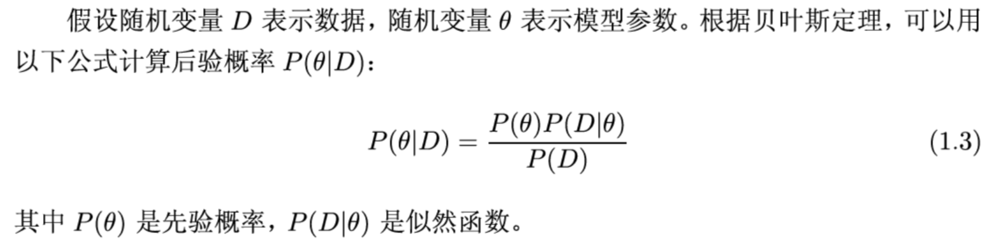

- 模型学习时，通常取后验概率最大的模型。
- 数据预测时，计算数据对后验概率分布的期望值

$$
P ( x | D ) = \int P ( x | \theta , D ) P ( \theta | D ) \mathrm { d } \theta
$$

---
##### 似然函数是什么
> claude
似然函数（Likelihood Function）是统计学和机器学习中的一个核心概念，尤其是在参数估计（如最大似然估计——MLE）中扮演着重要角色。

简单来说，似然函数描述的是在已知观测数据 $D$ 的前提下，关于模型参数 $\theta$ 的函数，**它衡量了不同参数取值对于解释已观测数据的合理程度**。

具体定义如下：

假设我们有一个概率模型，其参数为 $\theta$。这个模型能够产生观测数据 $D = {x_1, x_2, ..., x_n}$。我们通常会用 $P(D | \theta)$ 或 $L(\theta; D)$ 来表示似然函数。

$$ \text{似然函数} = L(\theta; D) = P(D | \theta) $$

这里 $P(D | \theta)$ 是在给定参数 $\theta$ 的条件下，观测到数据 $D$ 的概率（对于离散分布）或概率密度（对于连续分布）。

**关键区别：概率 vs 似然**
都是 $P(D|\theta)$ 表示
- 当 $\theta$（参数）是固定的，而 $D$（数据）是变量时，$P(D | \theta)$ 被视为概率（或概率密度）。它描述了数据的分布。
- 当 $D$（数据）是固定的（即我们已经观测到了这些数据），而 $\theta$（参数）是变量时，$P(D | \theta)$ 就被视为关于 $\theta$ 的似然函数 $L(\theta;D)$。它**衡量了不同参数取值对于解释已观测数据的合理程度**。

**最大似然估计（MLE）的思想**

最大似然估计的目标是找到一组参数 $\hat{\theta}$，使得似然函数 $L(\hat{\theta}; D)$ 取得最大值，即最大化合理程度。也就是说，认为使观测数据出现概率最大的那组参数，是最有可能（most likely）产生这组观测数据的真实参数（尽管真实参数未知）。

  $$ \hat{\theta}{MLE} = \arg\max{\theta} L(\theta; D) =
  \arg\max_{\theta} P(D | \theta) $$

**为什么叫“似然”而非“概率”？**

主要是为了强调视角的转变：在参数估计问题中，我们关心的不再是给定参数下数据出现的概率，而是给定数据下哪个参数最有可能是真实的。虽然数学表达式 $P(D | \theta)$ 在这两种情况下是相同的，但在似然函数的情境下，它的自变量是 $\theta$，而 $D$ 是一个常量。

**一个简单的例子：**
假设我们抛一枚硬币，正面朝上的概率为 $p$（这就是我们要估计的参数 $\theta$）。我们独立地抛了 3次，结果是：正，反，正（即数据 $D = {H, T, H}$）。

根据二项分布，观测到这个特定结果的概率（或似然函数）是：
$$ L(p; D) = P(D | p) = p \times (1-p) \times p = p^2(1-p) $$

极大似然估计就是要找到 $p$ 的值，使得 $L(p; D) = p^2(1-p)$ 最大。通过对 $p$ 求导并令其等于零，可以解出 $\hat{p} =2/3$。这与我们的直觉相符：在 3 次试验中有 2次正面，最合理的估计是 $p=2/3$。

记住似然函数的一般形式 $L(\theta;D)$，一般表现为概率的连乘形式是因为我们做了iid假设，推导得出的：

$$ 
L(\theta; D) = P(D | \theta) = P(x_1, x_2, ..., x_n | \theta) \\
= P(x_1 | \theta) \times P(x_2 | \theta) \times ... \times P(x_n | \theta)
$$

---

##### 贝叶斯学派 vs 频率学派
贝叶斯估计（学习、推理）与极大似然估计在思想上有很大的不同，代表着统计学中的贝叶斯学派和频率学派对统计的不同认识。其实两者可以简单的联系起来
- <span style='color:red'>假设先验分布是均匀分布，取后验概率最大，就能从贝叶斯估计得到极大似然估计（贝叶斯学派认为参数也是符合某种概率分布的）。</span>
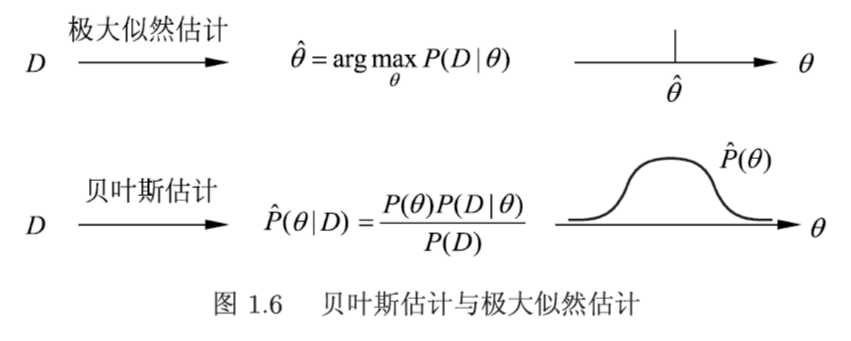

> 似然函数就是：把观测到的数据视为既定事实，将其联合概率（或密度）看作未知参数的函数，用来衡量不同参数“产生这组数据”的合理性
> 极大似然估计就是：在给定模型结构下，寻找一组参数，使得“当前这批观测数据出现的联合概率（或密度）最大”


#### 核方法
使用核函数表示和学习非线性模型的机器学习方法。

核函数支持向量机、核PCA、核k均值

把线性模型扩展到非线性模型，直接的做法是显示的定义从输入空间（低维空间）到特征空间（高维空间）的映射，在特征空间中进行内积运算和学习。核方法的技巧在于不显示的定义这个映射，而是直接定义核函数。这样可以简化计算达到同样的效果。

也就是说：如下图，不是先找到映射，而是直接定义一个K(x1,x2)
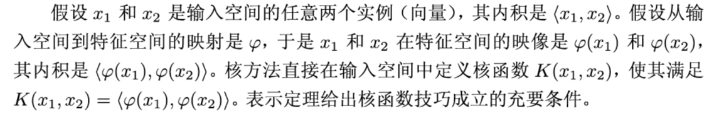

## 统计学习方法三要素

### 模型

#### 模型是什么?
- 首先要考虑的是学习什么样的模型。如监督学习过程中，模型就是所要学习的**条件概率分布**或者**决策函数**。
- 从而确定模型的假设空间
- 在假设空间内继续选择学习具体的模型

注意书中的这部分描述，整理了一下到表格里：

|   | 假设空间 $\cal F$ | 输入空间 $\cal X$ | 输出空间 $\cal Y$ | 参数空间   |
| ------ | ------ | ----- | --- | ----- |
| 决策函数     | $\cal F\it =\{f_{\theta} \| Y=f_{\theta}(x), \theta \in \bf R \it ^n\}$ | 变量  | 变量  |n维欧式空间 $\bf R\it ^n$ |
| 条件概率分布 | $\cal F\it =\{P\|P_{\theta}(Y\|X),\theta\in \bf R \it ^n\}$    | 随机变量  | 随机变量  | $\bf R\it ^n$ |

注意到这里：<span style='color:red'>使用条件概率分布时，X和Y都是随机变量</span>。

书中描述的时候，有提到**条件概率分布族**，这个留意下，后面[CH06](../CH06/README.md)有提到确认逻辑斯谛（logistic）分布属于指数分布族。

### 策略

有了模型的假设空间，进而需要考虑的是按照什么样的学习准则学习或选择最优的模型。

#### 损失函数与风险函数

> **损失函数**度量模型**一次预测**的好坏，**风险函数**度量**平均意义**下模型预测的好坏，是损失函数的期望。

##### 1. 损失函数(loss function)或代价函数(cost function)
损失函数定义为给定输入 $X$ 的预测值 $f(X)$ 和真实值 $Y$ 之间不一致衡量的**非负实值**函数，记作 $L(Y,f(X))$

##### 2. 风险函数(risk function)或期望损失(expected loss)
这个和模型的泛化误差的形式是一样的
$$
R_{exp}(f)=E_p[L(Y, f(X))]=\int_{\mathcal X\times\mathcal Y}L(y,f(x))P(x,y)\, {\rm d}x{\rm d}y
$$

模型 $f(X)$ 关于联合分布 $P(X,Y)$ 的平均意义下的损失(**期望**损失)，但是因为 $P(X,Y)$ 是未知的，所以前面的用词是**期望**，以及平均意义下的。

这个表示其实就是损失的均值，反映了对整个数据的预测效果的好坏，$P(x,y)$ 转换成 $\frac {\nu(X=x, Y=y)}{N}$ 更容易直观理解, 可以参考[CH09](../CH09/README.md)，6.2.2节的部分描述来理解，但是真实的数据N是无穷的。

学习的目标就是选择期望风险最小的模型

##### 3. 经验风险**(empirical risk)或经验损失(empirical loss) 
$$
R_{emp}(f)=\frac{1}{N}\sum^{N}_{i=1}L(y_i,f(x_i))
$$

模型 $f$ 关于**训练样本集**的平均损失

根据大数定律，当样本容量N趋于无穷大时，经验风险趋于期望风险。从而可用经验风险估计期望风险。

但现实中训练样本数量有限甚至很少，所以这样的估计不理想，所以需要对经验风险进行矫正：监督学习中的两个基本策略
- 经验风险最小化
- 结构风险最小化

经验风险最小化的策略认为：<span style='color:red'>经验风险最小的模型是最优模型。从而将问题转化为求解最优化问题。</span>

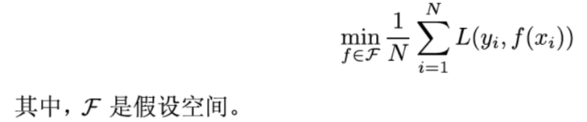

##### 4. **结构风险**(structural risk)
在经验风险上加上表示模型复杂度的正则化项或惩罚项。

$$
R_{srm}(f)=\frac{1}{N}\sum_{i=1}^{N}L(y_i,f(x_i))+\lambda J(f)
$$

$J(f)$ 为模型复杂度（类似正则化部分，表示对复杂模型的乘法）, $\lambda \geqslant 0$是系数，用以权衡经验风险和模型复杂度。

结构风险最小化的策略认为：<span style='color:red'>结构风险最小的模型是最优的模型，从而转化为求解最优化问题</span>
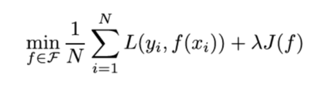

#### 常用损失函数

损失函数数值越小，模型就越好；注意这里和目标函数的不同，目标函数可max也可以min

1. 0-1损失（0-1 loss function)
$$
L(Y,f(X))=\begin{cases}1, Y \neq f(X) \\0, Y=f(X) \end{cases}
$$
2. 平方损失
$$
L(Y,f(X))=(Y-f(X))^2
$$
3. 绝对损失
$$
L(Y,f(X))=|Y-f(X)|
$$

4. 对数损失或对数似然损失(log-likelihood loss function)
$$
L(Y,P(Y|X))=-\log P(Y|X)
$$

这里 $P(Y|X)\leqslant 1$ ，对应的对数是负值，所以对数损失中包含一个负号，为什么不是绝对值？因为肯定是负的。
   

#### ERM与SRM

经验风险最小化(ERM)与结构风险最小化(SRM)

1. **极大似然估计**是经验风险最小化的一个例子
   当模型是条件概率分布，损失函数是对数损失函数时，经验风险最小化等价于极大似然估计
1. **贝叶斯估计**中的**最大后验概率估计**是结构风险最小化的一个例子
   当模型是条件概率分布，损失函数是对数损失函数，**模型复杂度由模型的先验概率表示**时，结构风险最小化等价于最大后验概率估计

<span style='color:red'>从而，监督学习问题就变成了经验风险或结构风险函数的最优化问题，这时经验或结构风险函数是最优化的目标函数。</span>

### 算法

这章里面简单提了一下，具体可以参考[CH12](../CH12/README.md)表格中关于学习算法的描述。

## 模型评估与模型选择

训练误差和测试误差是模型关于数据集的平均损失。

提到一句， 统计学习方法具体采用的损失函数未必是评估时使用的损失函数，这句理解下。参考下在数据科学比赛中给出的评分标准，与实际学习采用的损失函数之间的关系。

### 过拟合与模型选择

过拟合：训练误差很小但测试误差很大。（测试数据代表未观测到的数据）
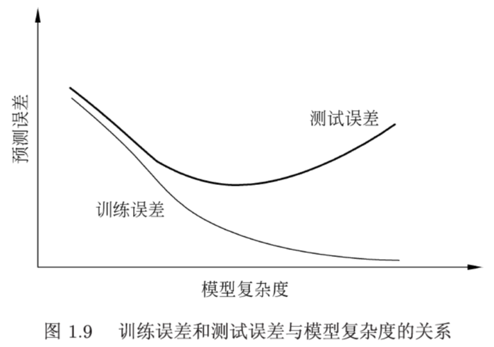

这部分讲到了最小二乘法，给了PRML中的一个例子。

这个问题中**训练数据**为
$$
T=\{(x_1, y_1),(x_2,y_2),\cdots,(x_N,y_N)\}
$$

**模型**为

$$
f_M(x,w)=w_0+w_1x+w_2x^2+\cdots+w_Mx^M=\sum\limits_{j=0}^Mw_jx^j
$$

经验风险最小化策略下

$$
L(w)=\frac{1}{2}\sum\limits_{i=1}^N(f(x_i,w)-y_i)^2
$$

将模型和训练数据带入到上式得到

$$
L(w)=\frac{1}{2}\sum\limits_{i=1}^N\left(\sum\limits_{j=0}^Mw_jx_i^j-y_i\right)^2=\frac{1}{2}\sum\limits_{i=1}^N(w\cdot x_i-y_i)^2
$$

这个问题要求 
$$
w=(w_0^*,w_1^*,\cdots,w_M^*)
$$

对 $w$ 求偏导令其为零，得到一系列方程，求解可以用梯度下降或者矩阵分解。

求解线性方程组 $Ax=b$ ，可以表示为 $x=A/b$ ，问题展开之后可以涉及到**矩阵分解**。


## 正则化与交叉验证

两种常用的避免过拟合的方法：
- 正则化
- 交叉验证

#### 正则化
模型选择的典型方法是正则化：使得结构风险最小化策略，限制模型的复杂度

正则化的一般形式：经验风险+正则化项
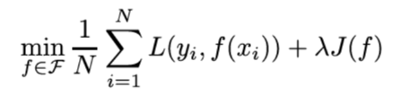

正则化符合奥卡姆剃刀原理：选择经验风险与模型复杂度同时较小的模型。

#### 交叉验证
另一种常用的模型选择方法是交叉验证
- 训练集：模型训练
- 验证集：验证超参数的选择即模型的选择
- 测试集：模型评估

- 简单
  - 简单比例划分
- S折(K折, K-Fold)[^1]
- 留一法

关于交叉验证，这里补充一点。

数据集的划分这个问题，书中有提到数据充足的情况下，将数据划分为三个部分，训练集，验证集和测试集。看到这里，不知道大家会不会有一样的问题：**验证集和测试集有什么区别？**

注意这里，在算法学习的过程中，测试集可能是固定的，但是验证集和训练集可能是变化的。比如K折交叉验证的情况下，分成K折之后，其中的K-1折作为训练集，1折作为验证集，这样针对每一个模型操作K次，计算平均测试误差，最后选择平均测试误差最小的模型。这个过程中用来验证模型效果的那一折数据就是**验证集**。交叉**验证**，就是这样一个使用**验证**集测试模型好坏的过程。他允许我们在模型选择的过程中，使用一部分数据（验证集）“偷窥”一下模型的效果。

## 泛化能力

- 现实中采用最多的方法是通过测试误差来评价学习方法的泛化能力

- 统计学习理论试图从理论上对学习方法的泛化能力进行分析

- 学习方法的泛化能力往往是通过研究泛化误差的**概率上界**进行的, 简称为泛化误差上界(generalization error bound)

这本书里面讨论的不多，在[CH08](../CH08/README.md)里面有讨论提升方法的误差分析, 提到$AdaBoost$不需要知道下界$\gamma$。在[CH02](../CH02/README.md)中讨论算法的收敛性的时候有提到误分类次数的上界.

注意泛化误差的定义，书中有说**事实上，泛化误差就是所学习到的模型的期望风险**


## 生成模型与判别模型

**监督学习方法**可分为**生成方法**(generative approach)与**判别方法**(discriminative approach)

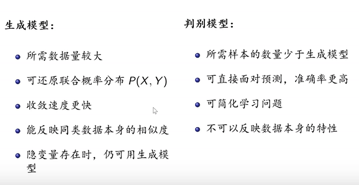

### 生成方法

generative approach

- 学习**联合概率分布** $P(X,Y)$，这可以通过分解成 $ P(X|Y) $ 和 $ P(Y) $ 来实现，然后求出条件概率分布 $P(Y|X)$ 作为预测模型
- 收敛速度快, 当样本容量增加时, 学到的模型可以更快收敛到真实模型
- 当存在隐变量时仍可以用

### 判别方法

discriminative approach

- 直接学习**条件概率** $P(Y|X)$ 或者**决策函数** $f(X)$
- 直接面对预测, 往往学习准确率更高
- 可以对数据进行各种程度的抽象,  定义特征并使用特征, 可以简化学习问题

## 监督学习的应用：分类问题、标注问题、回归问题

Classification, Tagging, Regression

###  Classification
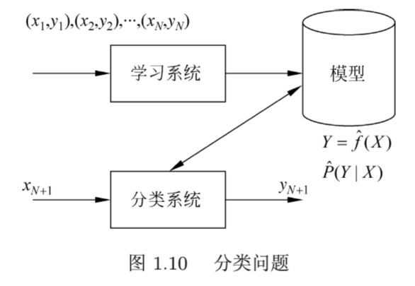

分类性能的评估指标：一般为准确率，对于二分类问题常用精确率和召回率。

精确率：
$$
P = \frac{TP}{TP+FP}
$$

召回率
$$
R = \frac{TP}{TP+FN}
$$

F1值：精确率和召回率的调和值
$$
\frac{2}{F_1} = \frac{1}{P} + \frac{1}{R}
$$

### Tagging
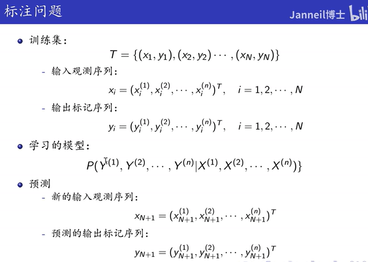

标注问题可以认为是分类问题的推广：**输入是一个观测序列，输出是一个标记序列或状态序列**
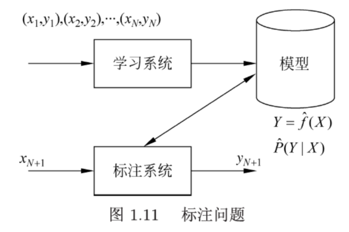

评估指标类似分类模型：准确率、精确率和召回率

### Regression

回归问题的学习等价函数拟合：选择一条函数曲线使其很好的拟合已知数据且很好的预测未知数据。
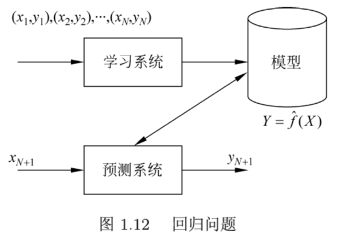

- 一元回归和多元回归
- 线性回归和非线性回归

- 图1.4和图1.5除了分类系统和标注系统的差异外，没看到其他差异，但实际上这两幅图中对应的输入数据有差异，序列数据的 $x_i = (x_i^{(1)},x_i^{(2)},\dots,x_i^{(n)})^T$ 对应了
- 图1.5和图1.6，回归问题的产出为 $Y=\hat f(X)$

## 参考

参考文献都是大部头，ESL，PRML在列

[1]: [ESL:7.10.1:K-Forld Cross Validation](##参考)
[2]: [NNDL](https://github.com/nndl/nndl.github.io/blob/master/chap-%E6%9C%BA%E5%99%A8%E5%AD%A6%E4%B9%A0%E6%A6%82%E8%BF%B0.pdf)

**[⬆ top](#导读)**
