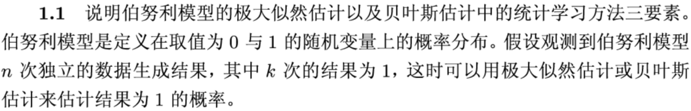

我们来逐步解这道题：

---

**题目：1.1 说明伯努利模型的极大似然估计以及贝叶斯估计中的统计学习方法三要素。**

首先，回顾“统计学习方法三要素”：

> **模型（Model）**、**策略（Strategy）**、**算法（Algorithm）**

这是李航《统计学习方法》中提出的核心框架，用于统一描述各种机器学习方法。

---

## 一、伯努利模型简介

伯努利模型是定义在取值为 {0, 1} 的随机变量上的概率分布：

设随机变量 $ X \sim \text{Bernoulli}(p) $，则：

$$
P(X=1) = p,\quad P(X=0) = 1 - p,\quad p \in [0,1]
$$

假设我们观测到 $ n $ 次独立实验结果，其中 $ k $ 次为 1，$ n-k $ 次为 0。

目标：估计参数 $ p $ —— 即结果为 1 的概率。

---

## 二、极大似然估计（MLE）

### 1. 模型（Model）

- 假设数据服从伯努利分布：$ X_i \sim \text{Bernoulli}(p) $
- 参数空间：$ p \in [0,1] $

### 2. 策略（Strategy）

- 使用**极大似然准则**：选择使观测数据出现概率最大的参数值。
- 似然函数：

$$
L(p) = P(D|p) = \prod_{i=1}^n p^{x_i}(1-p)^{1-x_i} = p^k (1-p)^{n-k}
$$

- 对数似然：

$$
\ell(p) = \log L(p) = k \log p + (n-k) \log(1-p)
$$

- 最大化对数似然：

$$
\frac{d\ell}{dp} = \frac{k}{p} - \frac{n-k}{1-p} = 0 \Rightarrow \hat{p}_{\text{MLE}} = \frac{k}{n}
$$

### 3. 算法（Algorithm）

- 解析求解导数等于零的点 → 得到闭式解 $ \hat{p} = \frac{k}{n} $
- 无需迭代，直接计算即可。

✅ **总结 MLE 三要素：**

| 要素 | 内容 |
|------|------|
| 模型 | 伯努利分布 $ P(x|p) = p^x(1-p)^{1-x} $ |
| 策略 | 极大化似然函数 $ \arg\max_p P(D\|p) $   |
| 算法 | 求导令其为0，得解析解 $ \hat{p} = k/n $ |

---

## 三、贝叶斯估计（Bayesian Estimation）

贝叶斯估计将参数 $ p $ 视为随机变量，引入先验分布，后通过贝叶斯定理更新为后验分布，再用后验期望或众数作为估计值。

常用共轭先验：**Beta 分布**

设先验：$ p \sim \text{Beta}(\alpha, \beta) $，即：

$$
P(p) = \frac{1}{B(\alpha,\beta)} p^{\alpha-1}(1-p)^{\beta-1}
$$

### 1. 模型（Model）

- 数据生成模型：$ X_i \sim \text{Bernoulli}(p) $
- 参数先验：$ p \sim \text{Beta}(\alpha, \beta) $
- 后验分布仍为 Beta 分布（共轭性）：

$$
P(p|D) \propto P(D|p)P(p) = p^k(1-p)^{n-k} \cdot p^{\alpha-1}(1-p)^{\beta-1} = p^{k+\alpha-1}(1-p)^{n-k+\beta-1}
$$

⇒ $ p|D \sim \text{Beta}(k+\alpha, n-k+\beta) $

### 2. 策略（Strategy）

- 使用**贝叶斯准则**：基于后验分布进行推断。
- 常见估计方式：
  - **后验均值（最小均方误差估计）**：

    $$
    \hat{p}_{\text{Bayes}} = \mathbb{E}[p|D] = \frac{k + \alpha}{n + \alpha + \beta}
    $$

  - **后验众数（最大后验估计 MAP）**：

    $$
    \hat{p}_{\text{MAP}} = \frac{k + \alpha - 1}{n + \alpha + \beta - 2},\quad (\text{当 } \alpha>1, \beta>1)
    $$

### 3. 算法（Algorithm）

- 利用共轭先验性质，直接写出后验分布形式。
- 计算后验均值或众数 → 得到估计值。
- 若无非共轭先验，则需用 MCMC 或变分推断等数值方法。

✅ **总结 贝叶斯估计 三要素：**

| 要素 | 内容 |
|------|------|
| 模型 | 伯努利_likelihood_ + Beta_prior_ ⇒ 后验_Beta_ |
| 策略 | 基于后验分布做推断（如取均值或众数） |
| 算法 | 利用共轭性直接计算后验；或数值近似 |

---

## 四、对比与补充

| 方面 | 极大似然估计 | 贝叶斯估计 |
|------|--------------|------------|
| 参数观点 | 固定未知常数 | 随机变量，有先验分布 |
| 输出 | 单点估计 $ \hat{p} = k/n $ | 整个后验分布，或点后验估计 |
| 小样本表现 | 可能过拟合（如 k=0 ⇒ p=0） | 更稳健（先验平滑） |
| 三要素差异 | 策略是最大化似然 | 策略是基于后验推断 |

---

## ✅ 最终答案整理：

> **伯努利模型的极大似然估计与贝叶斯估计中的统计学习方法三要素如下：**

---

### （1）极大似然估计：

- **模型**：假设数据服从伯努利分布 $ P(x|p) = p^x(1-p)^{1-x} $，参数 $ p \in [0,1] $。
- **策略**：采用极大似然准则，最大化似然函数 $ L(p) = p^k(1-p)^{n-k} $。
- **算法**：通过对数似然求导并令导数为零，得到解析解 $ \hat{p}_{\text{MLE}} = \frac{k}{n} $。

### （2）贝叶斯估计：

- **模型**：同样假设数据服从伯努利分布，但将参数 $ p $ 视为随机变量，赋予先验分布 $ p \sim \text{Beta}(\alpha, \beta) $，后验分布为 $ p|D \sim \text{Beta}(k+\alpha, n-k+\beta) $。
- **策略**：基于后验分布进行推断，常用后验均值 $ \hat{p}_{\text{Bayes}} = \frac{k+\alpha}{n+\alpha+\beta} $ 或后验众数作为估计值。
- **算法**：利用共轭先验性质直接计算后验分布及期望；若无共轭性，则使用MCMC或变分推断等数值方法。

📌 **注**：两种方法都遵循“模型→策略→算法”的三要素框架，体现了统计学习方法的统一性。贝叶斯方法通过引入先验，在小样本下更具鲁棒性，而MLE更简洁直观。

**贝叶斯估计依赖有先验的假定**，如果假定先验为 Beta(1,1)，则估计值为 $\frac{k+1}{n+1}$

---

**Beta 分布（Beta Distribution）** 是概率论与统计学中非常重要的一种连续概率分布，定义在区间 $(0, 1)$ 上。它在贝叶斯统计中扮演着核心角色，特别是作为**伯努利分布**和**二项分布**的**共轭先验**。

以下是关于 Beta 分布的详细解析：

---

### 1. 定义与公式

若随机变量 $X$ 服从参数为 $\alpha$ 和 $\beta$ 的 Beta 分布，记为 $X \sim \text{Beta}(\alpha, \beta)$，其概率密度函数（PDF）为：

$$
f(x; \alpha, \beta) = \frac{1}{B(\alpha, \beta)} x^{\alpha-1} (1-x)^{\beta-1}, \quad 0 < x < 1
$$

其中：
- **$\alpha > 0, \beta > 0$**：形状参数（Shape Parameters），决定了分布的形态。
- **$B(\alpha, \beta)$**：Beta 函数，作为归一化常数，确保积分等于 1。

#### Beta 函数 $B(\alpha, \beta)$
它与 Gamma 函数 $\Gamma(\cdot)$ 的关系为：
$$
B(\alpha, \beta) = \int_0^1 t^{\alpha-1}(1-t)^{\beta-1} dt = \frac{\Gamma(\alpha)\Gamma(\beta)}{\Gamma(\alpha+\beta)}
$$
对于整数 $n$，$\Gamma(n) = (n-1)!$。

---

### 2. 核心统计量

- **期望（均值）**：
  $$
  \mathbb{E}[X] = \frac{\alpha}{\alpha + \beta}
  $$
  *直观理解*：$\alpha$ 可以看作“成功”的计数，$\beta$ 看作“失败”的计数，均值就是成功率。

- **方差**：
  $$
  \text{Var}(X) = \frac{\alpha\beta}{(\alpha+\beta)^2(\alpha+\beta+1)}
  $$
  *性质*：当 $\alpha+\beta$ 越大（数据越多），方差越小，分布越集中在均值附近。

- **众数（Mode）**（当 $\alpha > 1, \beta > 1$ 时）：
  $$
  \text{Mode} = \frac{\alpha - 1}{\alpha + \beta - 2}
  $$

---

### 3. 为什么它很重要？（共轭先验）

Beta 分布最著名的应用是作为**伯努利分布**（Bernoulli）和**二项分布**（Binomial）的**共轭先验（Conjugate Prior）**。

#### 场景：估计硬币正面朝上的概率 $p$
1. **先验（Prior）**：假设我们对 $p$ 一无所知，或者有一些先验信念，设 $p \sim \text{Beta}(\alpha, \beta)$。
2. **似然（Likelihood）**：进行了 $n$ 次实验，观察到 $k$ 次正面（成功），$n-k$ 次反面（失败）。数据服从二项分布：
   $$
   P(D|p) \propto p^k (1-p)^{n-k}
   $$
3. **后验（Posterior）**：根据贝叶斯定理，后验分布正比于 先验 $\times$ 似然：
   $$
   \begin{aligned}
   P(p|D) &\propto P(D|p) \cdot P(p) \\
   &\propto \left[ p^k (1-p)^{n-k} \right] \cdot \left[ p^{\alpha-1} (1-p)^{\beta-1} \right] \\
   &\propto p^{k+\alpha-1} (1-p)^{n-k+\beta-1}
   \end{aligned}
   $$
   
   **结论**：后验分布依然是 Beta 分布！
   $$
   p|D \sim \text{Beta}(\alpha + k, \beta + n - k)
   $$

#### 直观解释
- $\alpha$ 和 $\beta$ 可以被理解为**伪计数（Pseudo-counts）**。
- $\alpha$ 代表先验中认为的“成功次数”。
- $\beta$ 代表先验中认为的“失败次数”。
- 更新过程非常简单：**后验参数 = 先验参数 + 观测数据**。
  - 新的 $\alpha' = \alpha_{\text{old}} + \text{成功次数}$
  - 新的 $\beta' = \beta_{\text{old}} + \text{失败次数}$

---

### 4. 参数 $\alpha, \beta$ 对形状的影响

Beta 分布非常灵活，通过调整 $\alpha$ and $\beta$，它可以呈现多种形态：

| 参数情况 | 形状描述 | 示例含义 |
| :--- | :--- | :--- |
| $\alpha = 1, \beta = 1$ | **均匀分布** $U(0,1)$ | 完全不知道概率是多少，所有可能性均等。 |
| $\alpha > 1, \beta > 1$ | **单峰分布**（钟形） | 有一定的先验知识，概率集中在某处。 |
| $\alpha < 1, \beta < 1$ | **U 型分布** | 认为概率极可能接近 0 或 1（两极分化）。 |
| $\alpha > \beta$ | **左偏**（峰值靠右） | 认为成功的概率较大（$p > 0.5$）。 |
| $\alpha < \beta$ | **右偏**（峰值靠左） | 认为成功的概率较小（$p < 0.5$）。 |
| $\alpha \to \infty$ | **趋近于狄拉克δ函数** | 数据量极大，不确定性消失，收敛到确定值。 |

---

### 5. 在机器学习中的应用

1. **A/B 测试**：
   - 比较两个版本的转化率。由于转化率是 $(0,1)$ 之间的概率，直接用 Beta 分布建模转化率的后验分布，计算两个分布重叠的概率来判断哪个版本更好。

2. **多臂老虎机（Multi-Armed Bandits）**：
   - 在 Thompson Sampling 算法中，每个老虎机的胜率都用 Beta 分布维护。每次采样一个概率值来选择动作，并在获得反馈后更新 $\alpha, \beta$。这完美平衡了**探索（Exploration）**和**利用（Exploitation）**。

3. **平滑（Smoothing）**：
   - 在自然语言处理或分类任务中，防止概率为 0（例如某个词从未在训练集出现）。使用 Beta 先验（如 $\alpha=1, \beta=1$ 即拉普拉斯平滑）可以避免零概率问题。

### 总结
Beta 分布是处理**概率的概率**（Probability of a probability）的最佳工具。它的数学形式优美（共轭性），物理意义直观（伪计数），是贝叶斯推断入门的基石。

---

# 在概率模型下，用对数损失（交叉熵）去最小化训练误差，本质上就是在做极大似然估计

这是一道非常经典的机器学习理论题，它完美串联了你刚才问的**极大似然**、**条件概率**以及**损失函数**的关系。

为了让你一目了然，我把证明过程分成三步，用最简单的数学语言写出来：

### 前提设定
*   **训练集**：\(D = \{(x_1, y_1), (x_2, y_2), \dots, (x_N, y_N)\}\)，共 \(N\) 个样本。
*   **模型**：模型输出的是**条件概率分布** \(P(y|x; \theta)\)，其中 \(\theta\) 是我们要学习的参数。
*   **经验风险**：模型在整个训练集上的平均损失，公式为 \(R_{emp} = \frac{1}{N} \sum_{i=1}^N L(y_i, P(y_i|x_i; \theta))\)。
*   **对数损失函数**：\(L = -\log P(y_i|x_i; \theta)\)。（注意，对于分类或概率预测，损失函数通常就是负对数似然）。

---

### 证明过程

**第一步：写出经验风险最小化的目标**
我们的目标是找到参数 \(\hat{\theta}\)，使得经验风险最小：
\[
 \hat{\theta} = \arg\min_\theta \frac{1}{N} \sum_{i=1}^N \Big[ -\log P(y_i|x_i; \theta) \Big] 
\]

**第二步：化简目标函数**
*   公式里的 \(\frac{1}{N}\) 是一个常数，不影响求极值（\(\arg\min\)），可以直接拿掉。
*   公式里的负号可以提出来，把“最小化”变成“最大化”。
于是目标等价于：
\[
 \hat{\theta} = \arg\max_\theta \sum_{i=1}^N \log P(y_i|x_i; \theta) 
\]

**第三步：转化为连乘（极大似然的形式）**
利用对数的性质 \(\sum \log = \log(\prod)\)，把连加变回连乘：
\[
 \hat{\theta} = \arg\max_\theta \log \left[ \prod_{i=1}^N P(y_i|x_i; \theta) \right] 
\]
因为对数函数 \(\log\) 是单调递增的，所以最大化“对数”等价于最大化“内部本身”：
\[
 \hat{\theta} = \arg\max_\theta \prod_{i=1}^N P(y_i|x_i; \theta) 
\]

**看！右边这个式子 \(\prod_{i=1}^N P(y_i|x_i; \theta)\) 是什么？**
它正是给定输入 \(x\) 时，模型输出真实标签 \(y\) 的**联合概率**。由于样本独立同分布，这就是标准的**似然函数** \(L(\theta)\)。

因此：
\[
 \hat{\theta}_{经验风险最小化} = \arg\max_\theta L(\theta) = \hat{\theta}_{极大似然估计} 
\]

证毕。

---

### 💡 核心总结（大白话翻译）

这道题想说的核心逻辑其实非常直观：

1.  **模型给出的是概率**：假设你的模型预测“这张图是猫的概率是 0.8”。
2.  **对数损失（交叉熵）**：如果你的真实标签是猫，损失就是 \(-\log(0.8)\)；如果真实标签是狗，损失就是 \(-\log(0.2)\)。**概率越小，损失越大。**
3.  **经验风险最小化**：我们要把整个数据集上的所有 \(-\log\) 加起来，让总和最小。
4.  **等价于极大似然**：让 \(-\log(\text{概率})\) 的和最小，就等同于让 \(\log(\text{概率})\) 的和最大，也就等同于让所有样本真实概率的**连乘积最大**。这正是极大似然估计在做的事。

**一句话：**
**在概率模型下，用对数损失（交叉熵）去最小化训练误差，本质上就是在做极大似然估计。**（这也是为什么逻辑回归、神经网络分类任务常用交叉熵损失的根本原因）。