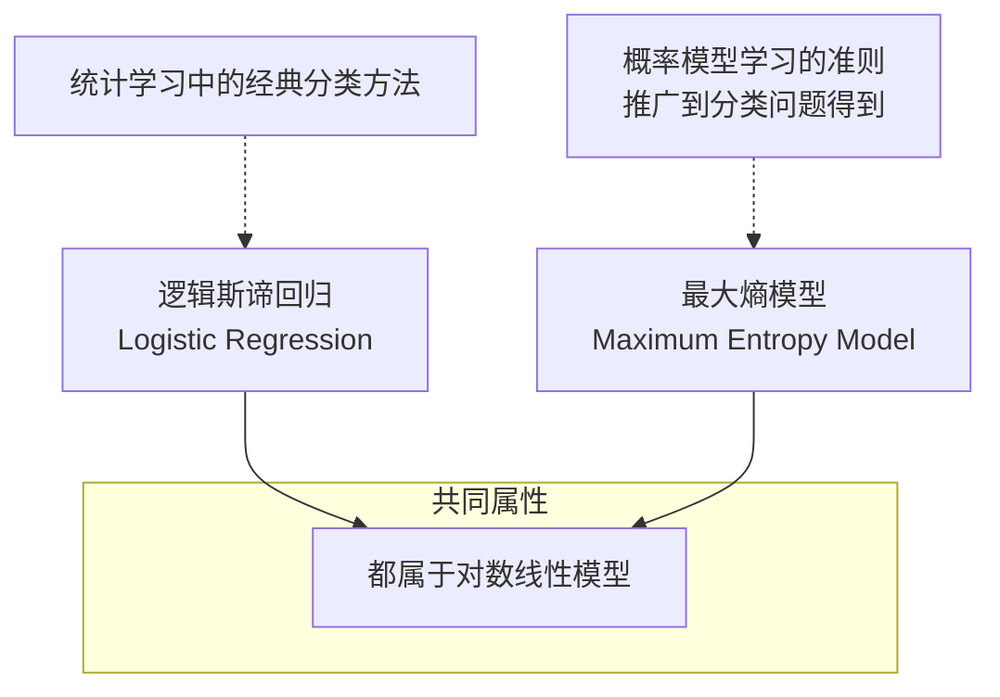
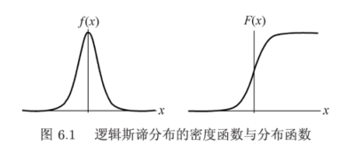

# CH06 逻辑斯谛回归与最大熵模型

## 前言

### 导读

- 这一章放在决策树后面，可能就因为熵的概念，对比前面[CH05](../CH05/README.md)部分理解对应的损失函数，发现其中的区别和联系。

- LR 做二分类的时候， $\cal{Y}=\{0,1\}$（对比感知机的{-1,1}）
- 在涉及到综合考虑各种模型损失函数作为0-1损失上界存在的情况中， $\cal{Y}=\{-1,+1\}$，这时方便使用函数间隔$yf(x)$

- 本章从 logistic 分布开始，在[CH04](../CH04/README.md)的时候，应该熟悉狄利克雷分布和高斯分布，对于离散和连续型的情况应该熟悉这两个分布，这样在这一章看到 logistic 分布的时候会更适应。

分类问题，可以表示成 one-hot 的形式，而 one-hot 可以认为是概率的一种表达，只是很确定的一种概率表达。而最大熵模型，是一种不确定的概率表达，其中这个概率，是一个条件概率，是构建的特征函数生成的概率。他们之间的关系有点像 **hard 和 soft**。

因为书中第四章并没有讲到高斯朴素贝叶斯(GNB)，有GNB做类比，这里可能更容易理解一点，这里重新推荐一下第四章的参考文献1[^1]，配合理解NB和LR的关系。

- 在模型参数估计的部分用到了 $\pi$ ，这个应该联想到狄利克雷分布

- 关于NB和LR的对比，Ng也有一篇文章[^2]

- 平方误差经过 Sigmoid 之后得到的是非凸函数

- 书中LR篇幅不大， 注意这样一句，在 logistic 回归模型中，输出Y=1的对数几率是输入x的线性函数。或者说，输出Y=1的对数几率是由输入x的线性函数表示的模型，即 logisitc 模型。

- LR和CRF也可以对比着看，在CRF中， 势函数是严格正的，通常定义为指数函数，概率无向图模型的联合概率分布$P(Y)$可以表示为如下形式：
  $$
  P(Y)=\frac{1}{Z}\prod_C\Psi_C(Y_C)\\
  Z=\sum_Y\prod_C\Psi_C(Y_C)\\
  $$
其实LR 也可以看成这样的形式，对应的$Z$有如下的表示形式
$$
Z=1+\sum_{k=1}^{K-1}\exp(w_k\cdot x)\\
$$
注意， 定义中的$x\in \mathbf{R}^{n+1},w_k\in\mathbf{R}^{n+1}$，这样，上面常数1是考虑到偏置项归一化了

实际上可以写成下面的形式
$$
P(Y=k|x)=\frac{\exp(w_k\cdot x)}{\sum_{k=1}^{K}\exp(w_k\cdot x)}
$$

其中第 $K$ 项对应了偏置，对应的$x$=1，所以是一个常数$w_0$，将分子归一化就得到了书中的表达方式，这就是出现个1的原因。

- 对于问题，什么情况下需要归一化，可以考虑下模型是不是要求这个特征要构成一个概率分布。

## logistic 回归模型

### logistic 分布
定义：设 $X$ 是连续随机变量，$X$ 服从 logistic 分布是指 $X$ 具有如下的分布函数和密度函数：
$$
F(x)=P(X\leqslant x)=\frac{1}{1+e^{-\frac{(x-\mu)}{\gamma}}} \\
\\
\\
f(x)=F^{'}(x)=\frac{e^{-\frac{(x-\mu)}{\gamma}}}{\gamma(1+e^{-\frac{(x-\mu)}{\gamma}})^2}
$$

- $\mu$ 是位置参数：控制图形的对称轴在哪个位置
- $\gamma$ 是形状参数：影响方差, $\gamma$ 越小越陡峭

分布函数式S型曲线，以点$(\mu,\frac{1}{2})$ 为中心对称点

关于 logistic ， 更常见的一种表达是 Logistic function
$$
\sigma(z)=\frac{1}{1+\exp(-z)}
$$
这个函数把实数域映射到(0, 1)区间，这个范围正好是概率的范围，而且可导，对于0输入，得到的是0.5，可以用来表示等可能性。
 
### 二项 logistic 回归模型

- 随机变量X取值为实数，$X \in R^n$
- $\cal{Y}=\{0,1\}$

由条件概率分布 $P(Y|X)$ 表示，**形式为参数化的logistic分布**:
$$
\begin{aligned}
P(Y=1|x)&=\frac{\exp(w\cdot x)}{1+\exp(w\cdot x)}\\
&=\frac{1}{e^{-(w\cdot x)}+1}\\
P(Y=0|x)&=\frac{1}{1+\exp(w\cdot x)}\\
&=\frac{e^{-(w\cdot x)}}{1+e^{-(w\cdot x)}}
\end{aligned}
$$

logisitic 回归比较两个条件概率值的大小，将实例x分到概率值较大的那一类。

**几率**：一个事件的几率(odds)是指该事件发生的概率与该事件不发生的概率的比值，如发生概率为p，则几率为:
$$
oods = \frac{p}{1-p}
$$

相应的对数几率为

$$
logit(p) = log\frac{p}{1-p}
$$

对于逻辑斯谛回归模型就表示成
$$
\log\frac{P(Y=1|x)}{1-P(Y=1|x)}=\color{red}\log\frac{P(Y=1|x)}{P(Y=0|x)}\color{black}=w\cdot x
$$

从而说输出Y=1的对数几率是由输入x的线性函数表示的模型。

**或者换个角度**：通过logistic regression 模型定义可以将线性函数$w·x$转换为概率：
$$
P(Y=1|x) = \frac{exp(w \cdot x)}{1+exp(w \cdot x)}
$$

### 模型参数估计

**1. 模型学习使用似然函数的表达**
$$
\prod^N_{i=1}[\pi(x_i)]^{y_i}[1-\pi(x_i)]^{1-y_i}
$$
这里利用了 logistic 回归模型 $y_i\in\{0,1\}$ 这个特点

**2. 更一般的表达**
$$
\prod_{i=1}^NP(y_i|x_i,W)
$$

---
文本中，似然函数的表达式为：

$$
\prod_{i=1}^{N} [\pi(x_i)]^{y_i} [1 - \pi(x_i)]^{1 - y_i}
$$

这个似然函数是**基于逻辑斯蒂回归模型的伯努利分布假设**推导出来的。下面我一步步解释它是如何得来的：

---

#### 似然函数的由来
##### 1. 模型设定

在二分类逻辑斯蒂回归中，我们假设：
- 输入特征向量 $ x_i \in \mathbb{R}^n $
- 输出标签 $ y_i \in \{0, 1\} $，服从**伯努利分布（Bernoulli Distribution）**
- 给定 $ x_i $，输出 $ Y = 1 $ 的概率为：
  $$
  P(Y = 1 | x_i) = \pi(x_i)
  $$
  其中 $ \pi(x_i) = \frac{1}{1 + e^{-w^T x_i}} $ 是 sigmoid 函数输出的概率值。
- 相应地，$ P(Y = 0 | x_i) = 1 - \pi(x_i) $

##### 2. 单个样本的概率质量函数（PMF）

对于一个样本 $ (x_i, y_i) $，其条件概率可以统一写成：

$$
P(y_i | x_i) = [\pi(x_i)]^{y_i} [1 - \pi(x_i)]^{1 - y_i}
$$

为什么？因为：

- 如果 $ y_i = 1 $，则上式变为 $ \pi(x_i)^1 \cdot (1 - \pi(x_i))^0 = \pi(x_i) $
- 如果 $ y_i = 0 $，则上式变为 $ \pi(x_i)^0 \cdot (1 - \pi(x_i))^1 = 1 - \pi(x_i) $

这正好对应伯努利分布的概率质量函数形式。

> ✅ **关键点**：这是伯努利分布的标准写法 —— 用指数形式统一表示两种情况。

##### 3. 独立同分布假设下的联合概率（似然函数）

训练数据集 $ T = \{(x_1, y_1), (x_2, y_2), \dots, (x_N, y_N)\} $ 中的样本通常被假设为**独立同分布（i.i.d.）**。

因此，所有样本同时出现的联合概率（即“似然”）就是每个样本概率的乘积：

$$
L(\theta) = P(y_1, y_2, \dots, y_N | x_1, x_2, \dots, x_N; \theta) = \prod_{i=1}^{N} P(y_i | x_i; \theta)
$$

代入上面的单样本概率公式：

$$
L(\theta) = \prod_{i=1}^{N} [\pi(x_i)]^{y_i} [1 - \pi(x_i)]^{1 - y_i}
$$

这就是你看到的**似然函数**。

##### 4. 极大似然估计（MLE）

为了找到最优参数 $ \theta $（通常是权重向量 $ w $），我们最大化这个似然函数：

$$
\hat{\theta}_{MLE} = \arg\max_\theta \prod_{i=1}^{N} [\pi(x_i)]^{y_i} [1 - \pi(x_i)]^{1 - y_i}
$$

由于连乘计算不便且容易下溢，通常取对数得到**对数似然函数**：

$$
\ell(\theta) = \log L(\theta) = \sum_{i=1}^{N} \left[ y_i \log \pi(x_i) + (1 - y_i) \log(1 - \pi(x_i)) \right]
$$

然后通过梯度上升或牛顿法等优化方法求解最大值。

##### 总结

✅ 似然函数的来源：

- 基于**伯努利分布建模**每个样本的输出 $ y_i $
- 利用**独立同分布假设**将联合概率写成乘积形式
- 使用**指数技巧**统一表达 $y_i=0 $ 和 $y_i=1$ 的情况
- 最终得到：
  $$
  \boxed{L(\theta) = \prod_{i=1}^{N} [\pi(x_i)]^{y_i} [1 - \pi(x_i)]^{1 - y_i}}
  $$

---

**对数似然**
使用对数似然会更简单， 会将上面表达式的连乘形式会转换成求和形式。对数函数为单调递增函数， 最大化对数似然等价于最大化似然函数。

$$
\begin{aligned}
\log \prod_{i=1}^N[\pi(x_i)]^{y_i}[1-\pi(x_i)]^{1-y_i}&=\sum_{i=1}^N[y_i\log(\pi(x_i))+(1-y_i)\log(1-\pi(x_i))]\\
&=\sum_{i=1}^N[y_i\log(\frac{\pi(x_i)}{1-\pi(x_i)})+\log(1-\pi(x_i))]\\
&=\sum_{i=1}^N[y_i(w\cdot x_i)-\log(1+\exp(w\cdot x_i))]
\end{aligned}
$$

好像不用这样麻烦，似然函数表示为

$$
\prod\limits_{i=1}\limits^NP(y_i|x_i,W)=\prod\limits_{i=1}\limits^N\frac{(\exp(w\cdot x_i))^{y_i}}{1+\exp(w\cdot x_i)}
$$

使用对数技巧

$$
\sum_{i=1}^N\log\frac{\exp(w\cdot x_i)}{1+\exp(w\cdot x_i)}=\sum_{i=1}^N[y_i(w\cdot x_i)-\log(1+\exp(w\cdot x_i))]
$$

##### Softmax Regression

多类分类的情况这个表达式是什么样的？感觉不能用0，1这样的技巧了。
$$
\prod\limits_{i=1}\limits^NP(y_i|x_i,W)=\prod\limits_{i=1}\limits^N\prod\limits_{l=1}^K \left(\frac{\exp(w_k\cdot x_i)}{\sum_{k=1}^K\exp(w_k\cdot x_i)}\right)^{I(y_i=l)}
$$
但是可以用指示函数。

通过似然函数，就将原始问题转变为了目标函数的最优化问题

### 多项logistic回归(也叫softmax回归)

假设离散型随机变量 $Y$ 的取值集合是 ${1,2,\cdots,K}$, 多项逻辑斯谛回归模型是
$$
\begin{aligned}
P(Y=k|x)&=\frac{\exp(w_k\cdot x)}{1+\sum_{k=1}^{K-1}\exp(w_k\cdot x)}, k=1,2,\dots,K-1\\
P(Y=K|x)&=\frac{1}{1+\sum_{k=1}^{K-1}\exp(w_k\cdot x)}\\
\end{aligned}
$$

这个公式和 softmax 公式等价

下面看这个多分类模型怎么来的[^4]。

##### 二元推广

计算 $K-1$ 种可能的取值发生的概率相对取值 $K$ 发生的概率的比值， 假设其取对数的结果是 $x$ 的线性模型， 有
$$
\begin{aligned}
\ln\frac{P(Y=1|x)}{P(Y=K|x)}&=w_1\cdot x\\
\ln\frac{P(Y=2|x)}{P(Y=K|x)}&=w_2\cdot x\\
\cdots\\
\ln\frac{P(Y=K-1|x)}{P(Y=K|x)}&=w_{K-1}\cdot x\\
\end{aligned}
$$

得到取值 ${1,2，\dots,K-1}$ 的概率表示

$$
\begin{aligned}
{P(Y=1|x)}&={P(Y=K|x)}\exp(w_1\cdot x)\\
{P(Y=2|x)}&={P(Y=K|x)}\exp(w_2\cdot x)\\
\cdots\\
{P(Y=K-1|x)}&={P(Y=K|x)}\exp(w_{K-1}\cdot x)\\
\color{red}{P(Y=k|x)}&\color{red}={P(Y=K|x)}\exp(w_k\cdot x), k=1,2,\dots,K-1
\end{aligned}
$$

上面红色部分有点像书上的(6.7)， 又有 $K$ 种可能取值概率和为1，可以得到下面推导

$$
\begin{aligned}
P(Y=K|x)&=1-\sum_{j=1}^{K-1}P(Y=j|x)\\
&=1-P(Y=K|x)\sum_{j=1}^{K-1}\exp(w_j\cdot x)\\
&=> P(Y=K|x) = \frac{1}{1+\sum_{j=1}^{K-1}\exp(w_j\cdot x)}
\end{aligned}
$$

所以之前红色部分的表达可以表示为

$$
\begin{aligned}
\color{red}{P(Y=k|x)}&\color{red}={P(Y=K|x)}\exp(w_k\cdot x), k=1,2,\dots,K-1\\
&=\frac{1}{1+\sum_{j=1}^{K-1}\exp(w_j\cdot x)}\exp(w_k\cdot x), k=1,2,\dots,K-1\\
&=\frac{\exp(w_k\cdot x)}{1+\sum_{j=1}^{K-1}\exp(w_j\cdot x)}, k=1,2,\dots,K-1\\
\end{aligned}
$$

这里公式和书上有点区别， 求和的用了$j$表示， 感觉不太容易造成误解。

##### 对数线性模型

假设归一化因子$Z$， 有如下关系
$$
\begin{aligned}
\ln (ZP(Y=k|x))&=w_k\cdot x, k=1,2,\dots,K\\
P(Y=k|x)&=\frac{1}{Z}\exp(w_k\cdot x), k=1,2,\dots,K
\end{aligned}
$$
又对所有的$P(Y=k|x)$可以形成概率分布， 有
$$
\begin{aligned}
\sum_{k=1}^KP(Y=k|x)&=1\\
&=\sum_{k=1}^K\frac{1}{Z}\exp(w_k\cdot x)\\
&=\frac{1}{Z}\sum_{k=1}^K\exp(w_k\cdot x)
\end{aligned}
$$

得到

$$
Z=\sum_{k=1}^K\exp(w_k\cdot x)
$$

所以

$$
P(Y=k|x)=\frac{1}{Z}\exp(w_k\cdot x)=\frac{\exp(w_k\cdot x)}{\sum_{k=1}^K\exp(w_k\cdot x)}, k=1,2,\dots,K
$$

上面这个叫Softmax，**针对多项的情况也叫 Softmax Regression**。

## 最大熵模型

### 信息量

单个事件所包含的信息量为自信息，是对某个特定事件发生时带来的”精细程度“的度量, 信息是概率的单调函数.

$$
h(x)=-\log_2{p(x)}
$$

符号保证了非负性. 低概率事件对应了高的信息量. 对数底选择是任意的, 信息论里面常用2, 单位是比特.

- 信息和概率的关系参考PRML中1.6节信息论部分的描述.

> 如果我们知道某件事件一定会发生, 那么我们就不会接收到信息.
> 于是, 我们对于信息内容的度量将依赖于概率分布 $p(x)$
>
> 如果我们有两个不相关的事件x, y, 那么我们观察到两个事件同时发生时获得的信息应该等于观察到事件各自发生时获得的信息之和, 即 $h(x,y)=h(x)+h(y)$,  这两个不相关的事件是独立的, 因此 $p(x,y)=p(x)p(y)$
>
> **根据这两个关系**, 很容易看出 $h(x)$ 一定与 $p(x)$ 的对数有关. 所以有
>
> $$h(x)=-\log_2{p(x)}=\log_2{\frac{1}{p(x)}}$$
>
> - 负号确保了信息非负
> - 低概率事件 $x$ 对应了高的信息.

### 熵和概率

熵可以从随机变量状态需要的平均信息量角度理解, 也可以从描述统计力学中无序程度的度量角度理解.

关于熵, 条件熵, 互信息, 这些内容在[第五章](../CH5/README.md)5.2节有对应的描述.

> 下面看下信息熵在PRML中的表达
>
> 假设一个发送者想传输一个随机变量 $x$ 的值给接受者. 在这个过程中, 他们传输的平均信息量可以通过求**信息 $h(x)$ 关于概率分布 $p(x)$ 的期望**得到.
>
> 这个重要的量叫做随机变量 $x$ 的熵

1. **概率** $\sum _{i=1}^{n}{p_i=1}$ $p \in [0,1]$

2. **熵**$Ent(D) \in [0, \log_2{|\mathcal Y|}]$, 熵可以大于1。熵是传输一个随机变量状态值所需的比特位**下界**(信息论角度的理解)，也叫香农下界。

3. **信息熵**是度量样本集合纯度最常用的一种指标。

$Ent(D)=-\sum \limits ^{|\mathcal Y|}_{k=1}p_k\log_2{p_k}$

- if $p=0$，then $p\log_2{p}=0$
- $Ent(D)$越小，D的纯度越高。非均匀分布比均匀分布熵要小

4. **联合熵(相当于并集)**

$H(X, Y) = H(X) + H(Y|X) = H(Y)+H(X|Y) = H(X|Y)+H(Y|X)+I(X;Y)$

这个通过Venn应该是相对容易记忆，是不是容易理解这个。

如果$X$和$Y$独立同分布，联合概率分布$P(X,Y)=P(X)P(Y)$ 

5. **条件熵**

条件熵是最大熵原理提出的基础，最大的是条件熵，这个在书中有写(定义6.3)

条件熵衡量了条件概率分布的均匀性

最大熵，就是最大这个**条件熵**

$$\begin{aligned}
p^*&=\arg\max\limits_{p\in \mathcal C}H(p)\\
&=\arg \max\limits_{p\in \mathcal C}(-\sum\limits_{x,y} {\tilde p(x)p(y|x)\log p(y|x) })
\end{aligned} $$

   接下来的概念，把熵的思想应用在模式识别问题中。

1. **互信息**

互信息(mutual information)，对应熵里面的交集，常用来描述差异性

一般的，熵 $H(Y)$ 与条件熵 $H(Y|X)$ 之差称为互信息。注意一下，这里[第五章](../CH5/README.md)中用到了 $H(D, A)$ 可以对应理解下。

1. Feature Selection 
2. Feature Correlation，刻画的是相互之间的关系。**相关性主要刻画线性，互信息刻画非线性**

2. **信息增益**：这个对应的是第五章的内容，决策树学习应用信息增益准则选择特征。
$$
g(D,A)=H(D)-H(D|A)
$$
信息增益表示得知$X$的信息而使类$Y$的信息的不确定性减少的程度。

在决策树学习中，信息增益等价于训练数据集中类与特征的互信息。

3. **相对熵 (KL 散度)** 

相对熵(Relative Entropy)描述差异性，从分布的角度描述差异性，可用于度量两个概率分布之间的差异。

KL散度不是一个度量，度量要满足交换性，KL散度不满足交换性，即KL(A,B)!=KL(B,A)。

KL散度满足非负性。

> 考虑由$p(x,y)$给出的两个变量 $x$ 和 $y$ 组成的数据集。如果变量的集合是独立的，那么他们的联合分布可以分解为边缘分布的乘积 $p(x,y)=p(x)p(y)$
>
> 如果变量不是独立的，那么我们可以通过考察**联合分布**与**边缘分布乘积**之间的KL散度来判断他们是否"接近"于相互独立。
>
> $$I(x,y)=KL(p(x,y)|p(x)p(y))=-\iint p(x,y) \ln {\left( \frac{p(x)p(y)}{p(x,y)}\right)}$$
>
> 这被称为变量$x$和变量$y$之间的互信息.
>
> --PRML 1.6.1

注意这里，参考下[第五章](../CH5/README.md)中关于互信息的描述

注意这里面类$Y$， 特征$X$。

互信息和条件熵之间的关系
$$
I(x,y)=H(X)-H(x|y)
$$
可以把互信息看成由于知道 $y$ 值而造成的 $x$ 的不确定性的减小(反之亦然)。*这个就是信息增益那部分的解释*。

4. **交叉熵**

刻画两个分布之间的差异
$$
\begin{aligned}
CH(p,q)&=-\sum\limits_{i=1}^{n}p(x_i)\log{q(x_i)}\\
&=-\sum\limits_{i=1}^{n}p(x_i)\log{p(x_i)}+\sum\limits_{i=1}^{n}p(x_i)\log{p(x_i)}-\sum\limits_{i=1}^{n}p(x_i)\log{q(x_i)}\\
&=H(p)+\sum\limits_{i=1}^{n}p(x_i)\log{\frac{p(x_i)}{q(x_i)}}\\
&=H(p)+KL(p||q)
\end{aligned}
$$

CNN时候常用

对于各种熵的理解，是构建后面的目标函数的基础。

