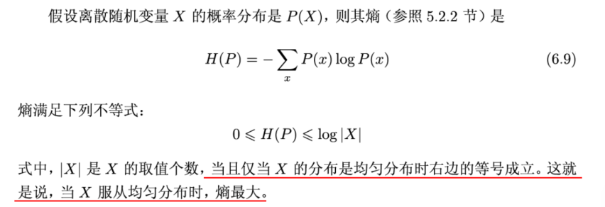

# 最大熵范围推导

你提供的图片中展示了**离散随机变量熵的定义**及其**基本不等式性质**：

> 假设离散随机变量 $ X $ 的概率分布是 $ P(X) $，则其熵（参照 5.2.2 节）是  

$$
H(P) = -\sum_{x} P(x) \log P(x) \tag{6.9}
$$  
> 熵满足下列不等式：  
> $$
0 \leq H(P) \leq \log |X|
$$

> 式中，$ |X| $ 是 $ X $ 的取值个数，**当且仅当 $ X $ 的分布是均匀分布时右边的等号成立**。

---

## 🎯 问题：下面公式的推导 —— 即推导 $ 0 \leq H(P) \leq \log |X| $，并说明等号成立条件

我们分两部分推导：

---

### ✅ 第一部分：证明 $ H(P) \geq 0 $

### 思路：
利用对数函数的性质和概率的非负性。

由于 $ P(x) \in [0,1] $，所以 $ \log P(x) \leq 0 $（以大于1为底，如自然对数或常用对数），因此 $ -P(x)\log P(x) \geq 0 $。

但注意：当 $ P(x)=0 $ 时，约定 $ 0 \log 0 = 0 $（极限意义下）。

所以每一项 $ -P(x)\log P(x) \geq 0 $，求和后仍 ≥ 0。

👉 **严格证明**：

考虑函数 $ f(p) = -p \log p $，定义在 $ p \in [0,1] $ 上。

- 当 $ p=0 $，定义 $ f(0)=0 $
- 当 $ p>0 $，因为 $ \log p \leq 0 $，所以 $ -p \log p \geq 0 $

因此，对所有 $ x $，有 $ -P(x)\log P(x) \geq 0 $，故

$$
H(P) = \sum_x -P(x)\log P(x) \geq 0
$$

✅ 得证：$ H(P) \geq 0 $

---

### ✅ 第二部分：证明 $ H(P) \leq \log |X| $，且等号当且仅当均匀分布时成立

这是信息论中的经典结论，通常用 **Jensen 不等式** 或 **Gibbs 不等式** 来证明。

---

## 🔹 方法一：使用 Gibbs 不等式（推荐）

### Gibbs 不等式：

设 $ P = \{p_1, p_2, ..., p_n\} $ 和 $ Q = \{q_1, q_2, ..., q_n\} $ 是两个概率分布（即 $ \sum p_i = \sum q_i = 1 $，且 $ p_i, q_i \geq 0 $），则：

$$
-\sum_{i=1}^n p_i \log p_i \leq -\sum_{i=1}^n p_i \log q_i
$$

等号成立当且仅当对所有 $ i $，$ p_i = q_i $。

---

### 应用到本题：

令 $ Q $ 为**均匀分布**，即 $ q_x = \frac{1}{|X|} $ 对所有 $ x \in X $。

代入 Gibbs 不等式：

$$
H(P) = -\sum_x P(x) \log P(x) \leq -\sum_x P(x) \log \left( \frac{1}{|X|} \right)
$$

计算右边：

$$
-\sum_x P(x) \log \left( \frac{1}{|X|} \right) = -\log \left( \frac{1}{|X|} \right) \cdot \sum_x P(x) = \log |X| \cdot 1 = \log |X|
$$

所以：

$$
H(P) \leq \log |X|
$$

等号成立当且仅当 $ P(x) = \frac{1}{|X|} $ 对所有 $ x $，即**均匀分布**。

✅ 得证！

---

## 🔹 方法二：使用 Jensen 不等式（另一种视角）

熵可以写成：

$$
H(P) = \mathbb{E}_P[-\log P(X)]
$$

函数 $ f(t) = -\log t $ 在 $ t > 0 $ 上是**凸函数**（因为二阶导数 $ f''(t) = \frac{1}{t^2} > 0 $）。

由 Jensen 不等式：

$$
\mathbb{E}[f(P(X))] \geq f(\mathbb{E}[P(X)])
$$

但这里要注意：我们不能直接对 $ P(X) $ 取期望，因为 $ P(X) $ 是一个随机变量，它的期望不是 1。

更标准的做法是构造一个辅助分布。

实际上，更清晰的方式还是用 Gibbs 不等式，如上所示。

---

# 📌 总结推导过程：

1. **下界 $ H(P) \geq 0 $**：
   - 因为每项 $ -P(x)\log P(x) \geq 0 $，求和非负。
   - 等号成立当且仅当某个 $ P(x)=1 $，其余为0（确定性事件），此时熵为0。

2. **上界 $ H(P) \leq \log |X| $**：
   - 利用 Gibbs 不等式，与均匀分布比较。
   - 得到 $ H(P) \leq \log |X| $。
   - 等号成立当且仅当 $ P(x) = \frac{1}{|X|} $，即均匀分布。

---

# 💡 补充说明：

- 这里的对数底数不影响不等式方向，只要底数 > 1（如 ln、log₂、log₁₀）。不同底数只是单位不同（nat、bit、hartley）。
- $ |X| $ 表示随机变量 $ X $ 的可能取值个数（支持集大小）。
- 最大熵原理：在给定约束下，均匀分布使熵最大——这正是这个不等式的体现。

---

✅ 所以，完整推导如下：

> 由 $ -P(x)\log P(x) \geq 0 $，得 $ H(P) \geq 0 $；  
> 由 Gibbs 不等式，取均匀分布 $ Q(x) = 1/|X| $，得  
> $$
H(P) \leq -\sum_x P(x) \log \frac{1}{|X|} = \log |X|
$$  
> 等号成立当且仅当 $ P(x) = \frac{1}{|X|} $，即均匀分布。

---

## Gibbs 不等式 推导过程

**Gibbs 不等式**是信息论和统计学中的一个基础不等式，它是证明熵的非负性、相对熵（KL 散度）的非负性以及最大熵原理的核心工具。

### 📜 Gibbs 不等式的内容

设 $P = \{p_1, p_2, \dots, p_n\}$ 和 $Q = \{q_1, q_2, \dots, q_n\}$ 是两个概率分布（即 $\sum p_i = \sum q_i = 1$，且 $p_i, q_i \geq 0$）。

则下列不等式成立：
$$
-\sum_{i=1}^n p_i \log p_i \leq -\sum_{i=1}^n p_i \log q_i
$$
或者等价地写成相对熵（KL 散度）的形式：
$$
D_{KL}(P || Q) = \sum_{i=1}^n p_i \log \frac{p_i}{q_i} \geq 0
$$
**等号成立当且仅当** 对所有 $i$，都有 $p_i = q_i$。

---

### 🧮 推导过程

推导的核心在于利用自然对数函数 $\ln x$ 的一个基本性质。为了通用性，我们通常先以自然对数 $\ln$ 为底进行推导，因为 $\log_b x = \frac{\ln x}{\ln b}$，常数因子 $\frac{1}{\ln b}$ （当 $b>1$ 时为正）不会改变不等号的方向。

#### 第一步：利用对数函数的切线性质

考虑函数 $f(x) = \ln x$。
我们知道 $\ln x$ 是一个**严格凹函数**（concave function），其二阶导数 $f''(x) = -\frac{1}{x^2} < 0$。

对于严格凹函数，其图像始终位于任意一点切线的**下方**（除了切点本身）。
我们在 $x=1$ 处取切线：
- 函数值：$\ln(1) = 0$
- 导数值：$f'(1) = \frac{1}{1} = 1$
- 切线方程：$y = 0 + 1 \cdot (x - 1) = x - 1$

因此，对于所有 $x > 0$，有：
$$
\ln x \leq x - 1
$$
**等号成立当且仅当 $x = 1$。**

> *注：如果你习惯用 $\log$，只要底数 $b > 1$，性质 $\log_b x \leq \frac{x-1}{\ln b}$ 依然成立，方向不变。*

#### 第二步：构造求和项

我们要证明的是 $\sum p_i \log \frac{p_i}{q_i} \geq 0$。
让我们考察每一项 $\ln \frac{q_i}{p_i}$（注意这里分子分母颠倒了，是为了凑出 $\leq$ 的形式，最后再变号）。

令 $x = \frac{q_i}{p_i}$。
**注意**：如果 $p_i = 0$，根据信息论约定 $0 \log 0 = 0$ 且 $0 \log \frac{0}{q_i} = 0$，这一项对求和没有贡献，我们可以只考虑 $p_i > 0$ 的项。如果 $p_i > 0$ 但 $q_i = 0$，则 $\ln \frac{0}{p_i} \to -\infty$，不等式显然成立（左边有限，右边 $-\infty$），所以我们假设 $p_i, q_i > 0$。

应用第一步的不等式 $\ln x \leq x - 1$：
$$
\ln \left( \frac{q_i}{p_i} \right) \leq \frac{q_i}{p_i} - 1
$$

#### 第三步：加权求和

在不等式两边同时乘以 $p_i$（因为 $p_i > 0$，不等号方向不变）：
$$
p_i \ln \left( \frac{q_i}{p_i} \right) \leq p_i \left( \frac{q_i}{p_i} - 1 \right)
$$
化简右边：
$$
p_i \ln \left( \frac{q_i}{p_i} \right) \leq q_i - p_i
$$

现在对所有 $i$ 从 $1$ 到 $n$ 求和：
$$
\sum_{i=1}^n p_i \ln \left( \frac{q_i}{p_i} \right) \leq \sum_{i=1}^n (q_i - p_i)
$$

拆分右边的求和：
$$
\sum_{i=1}^n (q_i - p_i) = \sum_{i=1}^n q_i - \sum_{i=1}^n p_i
$$

因为 $P$ and $Q$ 都是概率分布，所以 $\sum q_i = 1$ 且 $\sum p_i = 1$。
$$
\text{右边} = 1 - 1 = 0
$$

所以我们得到：
$$
\sum_{i=1}^n p_i \ln \left( \frac{q_i}{p_i} \right) \leq 0
$$

#### 第四步：整理得到最终形式

利用对数性质 $\ln \frac{a}{b} = -\ln \frac{b}{a}$，将左边变形：
$$
\sum_{i=1}^n p_i \left( - \ln \frac{p_i}{q_i} \right) \leq 0
$$
$$
- \sum_{i=1}^n p_i \ln \frac{p_i}{q_i} \leq 0
$$
两边同乘 $-1$（不等号方向改变）：
$$
\sum_{i=1}^n p_i \ln \frac{p_i}{q_i} \geq 0
$$

展开对数项 $\ln \frac{p_i}{q_i} = \ln p_i - \ln q_i$：
$$
\sum_{i=1}^n p_i (\ln p_i - \ln q_i) \geq 0
$$
$$
\sum_{i=1}^n p_i \ln p_i - \sum_{i=1}^n p_i \ln q_i \geq 0
$$
移项：
$$
-\sum_{i=1}^n p_i \ln p_i \leq -\sum_{i=1}^n p_i \ln q_i
$$

如果使用的是以 $b$ 为底的对数（$b>1$），只需在上述每一步除以 $\ln b$（正数），不等号方向保持不变。得证。

---

### ⚖️ 等号成立条件分析

回顾第一步中的不等式 $\ln x \leq x - 1$。
该不等式取等号 **当且仅当** $x = 1$。

在我们的推导中，$x = \frac{q_i}{p_i}$。
因此，总求和取等号，意味着求和中的**每一项**都必须取等号（因为只要有一项严格小于，总和就会严格小于 0）。

即对于所有 $p_i > 0$ 的 $i$，必须满足：
$$
\frac{q_i}{p_i} = 1 \implies p_i = q_i
$$

对于 $p_i = 0$ 的项，如前所述，它们对 KL 散度的贡献定义为 0，不影响等号成立的判断（只要对应的 $q_i$ 也是合理的概率值）。但在严格的概率分布相等定义中，通常要求对所有 $i$，$p_i = q_i$。

**结论**：Gibbs 不等式取等号 **当且仅当** 两个分布完全相同 ($P = Q$)。

---

### 💡 直观理解

Gibbs 不等式告诉我们：**“用错误的分布 $Q$ 来描述真实分布 $P$ 所产生的平均编码长度（交叉熵），永远大于或等于用真实分布 $P$ 自身描述的平均编码长度（熵）。”**

多出来的那部分长度，就是 $D_{KL}(P||Q)$，也就是信息的“损失”或“距离”，它永远是非负的。