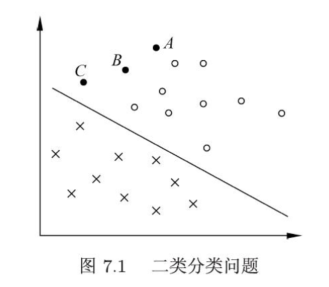
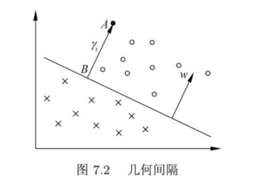
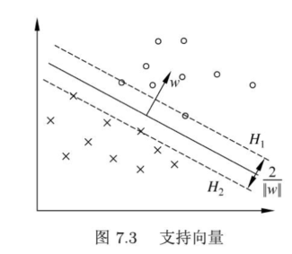
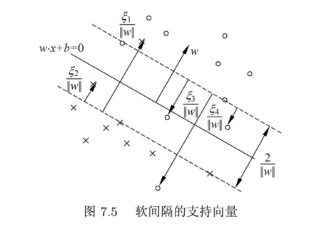
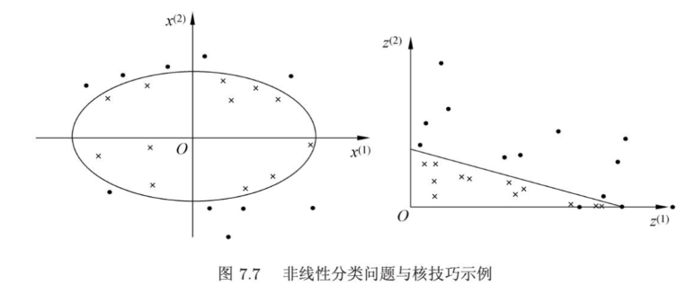

# CH07 支持向量机


[TOC]

## 前言

### 导读

支持向量机是一种二类分类模型，这类似于感知机

**基本模型**:是定义在`特征空间`上的间隔最大的**线性分类器**，这有别于感知机。

**核技巧**：支持向量机还包括核技巧， 通过引入核技巧使它能够成为实质上的**非线性分类器**。

**间隔最大化**：支持向量机学习策略是间隔最大化，可形式化为一个求解凸二次规划的问题，也等价于正则化的合页损失函数的最小化问题。

支持向量机模型分为（由简至繁）：
1. 线性可分支持向量机
   1. 也称为硬间隔svm
   2. 数据线性可分，求得硬间隔最大化
2. 线性支持向量机
   1. 也称软间隔svm
   2. 数据接近线性可分，求得软间隔最大化
3. 非线性支持向量机
   1. 数据线性不可分，需要借助核技巧，求得软间隔最大化

<span style='color:red'>核技巧（核方法）：当输入空间为欧式空间或离散集合、特征空间为希尔伯特空间时，核函数（kernel function)表示将输入从输入空间映射到特征空间得到的特征向量之间的内积。通过使用核函数可以学习非线性svm，等价于隐式的在高维特征空间中学习线性支持svm</span>

---
> claude

[核技巧图解](./kernel_method_diagram.md)

[希尔伯特空间（Hilbert Space）](./hilbert_space.md)

---

线性支持向量机假设输入空间和特征空间的**元素一一对应**，并将输入空间中的输入映射为特征空间的特征向量；非线性支持向量机利用一个从输入空间到特征空间的**非线性映射**将输入映射为特征向量。


判别模型:符号函数, Sign, 0 对应了超平面(hyper plane), >0 与 <0 对应了半空间(half space)

仿射变换是保凸变换

<span style='color:red'>分离超平面将特征空间划分为两部分，一部分是正类，一部分是负类。法向量指向的一侧是正类， 另一侧为负类</span>

关于SVM的历史可以参考附录2[^2]，Vapnik的1995年的那个文章名字叫Support-vector networks，主要是提出了soft margin，在这篇文章的附录中给出了线性可分支持向量机与线性支持向量机的推导。同年Vapnik将支持向量机推广到支持向量回归，发表了文章统计学习理论的本质， 这个有中译版本，见书中本章参考文献[4]
- Vapnik全名弗拉基米尔·万普尼克， 出生于苏联， VC理论的主要创建人之一，统计学习理论之父。1990年底移居美国，1991-2001年间，他在AT&T工作。2006年成为美国国家工程院院士。2014年加入Facebook人工智能实验室。
- 1995年SVN的文章结尾有这样的描述：```支持向量网络结合了三个想法：最优超平面的解决方案技术（允许解向量在支持向量上展开），点积卷积的思想（将解曲面从线性扩展到非线性），以及软边界的观念（允许训练集上存在误差）```
- KKT条件是该最优化问题的充分必要条件。
- 样本比较多的时候，Boosting 和 RF 往往能得到最好的效果，但是数据集较少的时候，SVM的效果可能会比较好。

---

这一章介绍了几个算法

1. 算法7.1 最大间隔法，针对线性可分支持向量机，直接求$w^*,b^*$
2. 算法7.2 学习的对偶算法，求$\alpha$进一步求$w^*,b^*$
3. 算法7.3 线性支持向量机的学习算法， 增加超参$C$，求$\alpha$进一步求$w^*,b^*$
4. 算法7.4 非线性支持向量机的学习算法，进一步引入核函数$K(x,z)$，求$\alpha$进一步求$b^*$
5. 算法7.5 序列最小最优化

注意前四个算法里面，都没有写该怎么去求解$\alpha$，最后一节**序列最小最优化**讨论了具体实现。也就是算法7.5给出了求解$\hat\alpha$的方法。

另外，注意对比算法7.3和算法7.4，关注输出，关注$b^*​$.

## 线性可分支持向量机与硬间隔最大化

支持向量机的学习是在<span style='color:red'>特征空间</span>（而非输入空间，尽管某些情况下输入空间和特征空间是同一个）中进行的
- 线性可分svm（硬间隔）和线性支持svm（软间隔）
  - 假设输入空间和特征空间的元素一一对应
- 非线性svm（核函数+软间隔）
  - 利用一个非线性映射将输入从输入空间映射到特征空间的特征向量


### 问题定义
假设给定一个特征空间上的训练数据集

$$
T = \{(x_1, y_1), (x_2, y_2), \cdots, (x_N, y_N)\}
$$

其中，$x_i \in \mathcal{X} = \mathbf{R}^n$，$y_i \in \mathcal{Y} = \{+1, -1\}$，$i = 1, 2, \cdots, N$。$x_i$ 为第 $i$ 个特征向量，也称为实例，$y_i$ 为 $x_i$ 的类标记。当 $y_i = +1$ 时，称 $x_i$ 为正例；当 $y_i = -1$ 时，称 $x_i$ 为负例。$(x_i, y_i)$ 称为样本点。

---

样本点 $(x_i,y_i)$。svm 学习目标是在特征空间中找到一个分离超平面，能够将实例分到不同的类。分离超平面对应于方程 $w \cdot x + b = 0$

当训练数据集线性可分时，存在无穷个分离超平面可将两类数据正确分类
- 感知机利用误差最小的策略，解有无穷多个（取决于w和b的初始化值、样本学习的顺序和学习率）
- 线性可分svm则是利用硬间隔最大化求解分离超平面，解是唯一的

如果求出了上述方程的解$w^*, b^*$，就可得到

分离超平面
$$
w^*\cdot x+b^*=0
$$

相应的分类决策函数
$$
f(x)=sign(w^*\cdot x+b^*)
$$

### 间隔


- 分类预测确信度：一个点距离分离超平面的远近可以表示分类预测的确信程度(如上图中的A/B/C。对A的判别确信度高于C），在超平面 $w \cdot x + b = 0$ 确定的情况下，$|w \cdot x + b|$ 能够**相对的**表示点x距离超平面的远近（实际距离为 $\frac{|w \cdot x + b|}{|w|} $ )。
- 分类是否正确：$w \cdot x + b$ 的符号与类标记y的符号是否一致能够表示分类是否正确
- 从而得出函数间隔：$y(w \cdot x + b )$ 可以用来表示分类的正确性和确信度
  - 注意，输出空间为 {-1,+1}

#### 函数间隔

对于给定数据集 $T$ 和超平面 $(w,b)$，定义超平面 $(w,b)$ <span style='color:red'>关于样本点$(x_i,y_i)$的函数间隔</span>为
$$
\hat \gamma_i=y_i(w\cdot x_i+b)
$$

定义超平面 $(w,b)$ <span style='color:red'>关于训练数据集 $T$ 的函数间隔</span>为超平面$(w,b)$关于$T$中所有样本点$(x_i,y_i)$的函数间隔之最小值，即
$$
\hat \gamma=\min_{i=1,\cdots,N}\hat\gamma_i
$$

函数间隔可以表示分类预测的**正确性**及**确信度**。（这里注意函数间隔和w和b的大小有关，如果成比例的改变w和b，如变为2w和2b，则函数间隔变为2倍，而实际的分离超平面并未改变，所以引入约束|w|=1）

#### 几何间隔


对于给定的训练数据集 $T$ 和超平面 $(w, b)$，定义超平面 $(w, b)$ 关于样本点 $(x_i, y_i)$ 的几何间隔为

$$
\gamma_i = y_i \left( \frac{w}{\|w\|} \cdot x_i + \frac{b}{\|w\|} \right) \tag{7.5}
$$

定义超平面 $(w, b)$ 关于训练数据集 $T$ 的几何间隔为超平面 $(w, b)$ 关于 $T$ 中所有样本点 $(x_i, y_i)$ 的几何间隔之最小值，即

$$
\gamma = \min_{i=1,\cdots,N} \gamma_i \tag{7.6}
$$

超平面 $(w,b)$ 关于样本点 $(x_i,y_i)$ 的几何间隔一般是实例点到超平面的带符号的距离，当样本点被超平面正确分类时就是实例点到超平面的距离。

#### 函数间隔和几何间隔的关系
下面的关系：
$$
\gamma_i = \frac{\hat{\gamma}_i}{\|w\|} \tag{7.7}
$$

$$
\gamma = \frac{\hat{\gamma}}{\|w\|} \tag{7.8}
$$

如果 $\|w\| = 1$，那么函数间隔和几何间隔相等。如果超平面参数 $w$ 和 $b$ 成比例地改变（超平面没有改变），函数间隔也按此比例改变，而几何间隔不变。

#### 间隔最大化
svm的基本思想：<span style='color:red'>求解能够正确划分训练数据集并且几何间隔最大的分离超平面</span>
1. 几何间隔最大: 
$$
\begin{aligned}
\max_{w, b} \quad \gamma \\
--- \\
\gamma = \min_{i=1,\cdots,N} \gamma_i \\
= \min_{i=1,\cdots,N} y_i \left( \frac{w}{\|w\|} \cdot x_i + \frac{b}{\|w\|} \right) \\
= \min_{i=1,\cdots,N} y_i \left( \frac{w \cdot x_i + b}{\|w\|} \right)
\end{aligned}
$$
2. 正确划分：$y_i(w \cdot x_i + b)>=\gamma$(因为 $\gamma$ 和 $x_i$ 到超平面的距离 $|w^T \cdot x_i + b|$ 有关系)

---
### svm为什么不用函数间隔判断
支持向量机（SVM）不使用函数间隔来判断分类边界的原因主要有以下几点：
**几何间隔 vs 函数间隔**
1. 几何间隔是标准化的度量
   - 几何间隔表示样本点到超平面的实际欧几里得距离：$\frac{|w^T x +
b|}{||w||}$
   - 函数间隔只是 $y(w^T x + b)$，没有考虑权重向量的尺度
1. 函数间隔的尺度问题
   - 如果我们将权重向量 $w$ 和偏置 $b$ 同时乘以一个常数 $k > 0$，超平面本身不变，但函数间隔会变为原来的 $k$ 倍：$y(kw^T x + kb) = k y(w^T x + b)$
   - 这意味着**函数间隔不是超平面的固有属性，而是受参数尺度影响**
2. 优化目标的一致性
   - SVM的优化目标是最小化 $\frac{1}{2}||w||^2$，这等价于最大化几何间隔
   - 几何间隔 $\frac{|w^T x + b|}{||w||}$ 已经被归一化，不受参数尺度影响
   - 这确保了优化目标与最大化真实距离的一致性

**数学本质**

SVM希望找到使所有训练样本的最小几何间隔最大化的超平面。如果使用函数间隔，由于尺度不变性问题，无法确定唯一的最优解。

因此，SVM采用几何间隔（或等价地约束函数间隔为1并最小化 $||w||^2$ ）来确保分类边界的唯一性和稳定性。

---

间隔最大化的直观解释：以充分大的确信度对训练数据进行分类，即不仅将正负实例点分开，而且对最难分的实例点（离超平面最近的点）也有足够大的确信度将他们分开。这样的超平面对未知的新实例有很好的分类预测能力（即泛化能力）。

最大几何间隔分离超平面：
$$
\begin{aligned}
& \max_{w, b} \quad \gamma \\
& \text{s.t.} \quad y_i \left( \frac{w}{\|w\|} \cdot x_i + \frac{b}{\|w\|} \right) \geqslant \gamma, \quad i = 1, 2, \cdots, N
\end{aligned}
$$

结合和函数间隔的关系，得到：
$$
\begin{aligned}
& \max_{w, b} \quad \frac{\hat{\gamma}}{\|w\|} \\
& \text{s.t.} \quad y_i (w \cdot x_i + b) \geqslant \hat{\gamma}, \quad i = 1, 2, \cdots, N
\end{aligned}
$$

而 $\hat{\gamma}$ 的取值并不影响最优化问题的求解（数据定了后 $\hat{\gamma}$ 即确定了），直接取 $\hat{\gamma} = 1$，上面求解转换等价于
$$
\begin{aligned}
& \min_{w, b} \quad \frac{1}{2} \|w\|^2 \\
& \text{s.t.} \quad y_i (w \cdot x_i + b) - 1 \geqslant 0, \quad i = 1, 2, \cdots, N
\end{aligned}
$$

由此求解最优解 $w^*,b^*$

定理：如训练数据集T线性可分，则可将训练数据集中的样本点完全正确分开的最大间隔分离超平面存在且唯一。

---

### 为啥gamma的取值不影响
你问到了 SVM 推导中一个**极其关键又容易忽略的点**：为什么函数间隔 $\hat{\gamma}$ 的取值不影响最终优化问题的解？甚至可以直接设为 1？

####  核心答案：

> **因为 $w$ 和 $b$ 可以任意缩放（scale），而超平面本身不变，所以我们可以“归一化”函数间隔 $\hat{\gamma}$，使其等于 1，从而简化问题。**

这本质上是一个**尺度不变性（scale invariance）**的问题。

#### 🔍 详细解释：

##### 1. 回顾定义：

- **函数间隔（functional margin）**：
  $$
  \hat{\gamma}_i = y_i (w \cdot x_i + b)
  $$
  它依赖于 $w, b$ 的具体数值大小。

- **几何间隔（geometric margin）**：
  $$
  \gamma_i = \frac{y_i (w \cdot x_i + b)}{\|w\|} = \frac{\hat{\gamma}_i}{\|w\|}
  $$
  它是点到超平面的实际距离，与 $w, b$ 的缩放无关。

##### 2. 关键观察：**超平面由方向决定，不是由长度决定**

考虑超平面方程：

$$
w \cdot x + b = 0
$$

如果你把 $w$ 和 $b$ 同时乘以一个正数 $\lambda > 0$，得到：

$$
(\lambda w) \cdot x + (\lambda b) = 0
$$

→ 这仍然是**同一个超平面！**

但此时：

- 函数间隔变为：$\hat{\gamma}_i' = y_i (\lambda w \cdot x_i + \lambda b) = \lambda \hat{\gamma}_i$
- 几何间隔不变：$\gamma_i' = \frac{\lambda \hat{\gamma}_i}{\|\lambda w\|} = \frac{\lambda \hat{\gamma}_i}{\lambda \|w\|} = \gamma_i$

✅ 所以：**几何间隔是不变的，函数间隔会随缩放改变。**

##### 3. 回到你的公式：

原始问题是：

$$
\max_{w,b} \quad \frac{\hat{\gamma}}{\|w\|} \\
\text{s.t.} \quad y_i(w \cdot x_i + b) \geqslant \hat{\gamma}, \quad i=1,\dots,N
$$

其中 $\hat{\gamma} = \min_i y_i(w \cdot x_i + b)$ —— 即最小函数间隔。

现在，假设我们有一组最优解 $(w^*, b^*)$，对应的最小函数间隔是 $\hat{\gamma}^*$。

那么，我们对这组解进行缩放：

令 $w' = \frac{w^*}{\hat{\gamma}^*}, \quad b' = \frac{b^*}{\hat{\gamma}^*}$

则新的函数间隔为：

$$
y_i(w' \cdot x_i + b') = y_i \left( \frac{w^*}{\hat{\gamma}^*} \cdot x_i + \frac{b^*}{\hat{\gamma}^*} \right) = \frac{1}{\hat{\gamma}^*} \cdot y_i(w^* \cdot x_i + b^*) \geqslant \frac{\hat{\gamma}^*}{\hat{\gamma}^*} = 1
$$

也就是说，**通过缩放，我们总可以让最小函数间隔变成 1！**

而且，目标函数：

$$
\frac{\hat{\gamma}}{\|w\|} = \frac{\hat{\gamma}^*}{\|w^*\|} = \frac{1}{\|w'\|}
$$

→ 所以最大化 $\frac{\hat{\gamma}}{\|w\|}$ 等价于在约束 $y_i(w \cdot x_i + b) \geq 1$ 下，**最小化 $\|w\|$**！

---

## ✅ 为什么“$\hat{\gamma}$ 的取值不影响求解”？

因为：

- 对于任何一组 $(w, b)$，你都可以通过缩放让它满足 $\min_i y_i(w \cdot x_i + b) = 1$。
- 缩放不改变超平面，也不改变几何间隔。
- 所以，无论原来 $\hat{\gamma}$ 是多少，我们都可以“标准化”它为 1，然后只优化 $w, b$ 的方向和相对大小。
- 最终的最优超平面是一样的！

> 💡 换句话说：**$\hat{\gamma}$ 不是一个自由变量，它是被 $w, b$ 决定的；而我们可以通过调整 $w, b$ 的尺度，强制让 $\hat{\gamma}=1$，而不损失一般性。**

---

## 🧩 类比理解：

想象你在画一条直线，用方程 $2x + 3y - 6 = 0$。

你也可以写成 $4x + 6y - 12 = 0$，或 $x + 1.5y - 3 = 0$ —— 都是同一条线！

SVM 中说：“为了方便，我统一规定这条线的‘函数间隔’必须是 1”，就像说：“我用最简整数系数来表示这条线”。

这样做的目的是**消除冗余自由度**，让优化问题更简洁、更容易求解。

#### 📌 总结：

| 问题 | 解答 |
|------|------|
| 为什么 $\hat{\gamma}$ 取值不影响？ | 因为 $w, b$ 可缩放，且缩放不改变超平面和几何间隔。 |
| 为什么能直接设 $\hat{\gamma}=1$？ | 因为我们总能通过缩放 $w, b$ 使得最小函数间隔为 1，这是不失一般性的。 |
| 这样做有什么好处？ | 将原问题转化为标准凸优化问题：$\min \frac{1}{2}\|w\|^2$ s.t. $y_i(w·x_i+b)\geq1$，便于求解。 |

---

🎯 所以，这不是“随便设”，而是**利用尺度不变性做的等价变换**，是 SVM 理论推导中的经典技巧！

希望这个解释让你彻底明白背后的数学美感 😊

---
### 从公式看不到 约束 样本点被正确分类了（线性可分svm有个前提就是样本点能够线性可分）
你问得非常好！👏  
确实，从原始公式：

$$
\max_{w,b} \quad \gamma \\
\text{s.t.} \quad y_i \left( \frac{w}{\|w\|} \cdot x_i + \frac{b}{\|w\|} \right) \geqslant \gamma, \quad i = 1,2,\cdots,N
$$

**表面上看，并没有显式写出“$y_i (w \cdot x_i + b) > 0$”这样的正确分类约束。**

但——**这个约束其实已经隐含在不等式和最大化目标中了！**

#### 🔍 为什么“正确分类”是隐含的？

我们来一步步拆解：

##### ✅ 第一步：理解 $y_i \in \{+1, -1\}$

- 如果 $y_i = +1$（正例），那么要求：
  $$
  \frac{w}{\|w\|} \cdot x_i + \frac{b}{\|w\|} \geqslant \gamma
  $$
  → 即预测值 $\hat{y}_i = \text{sign}(w \cdot x_i + b)$ 应该为 +1，且距离至少为 $\gamma$

- 如果 $y_i = -1$（负例），那么要求：
  $$
  -\left( \frac{w}{\|w\|} \cdot x_i + \frac{b}{\|w\|} \right) \geqslant \gamma
  \Rightarrow
  \frac{w}{\|w\|} \cdot x_i + \frac{b}{\|w\|} \leqslant -\gamma
  $$
  → 预测值应为 -1，且距离至少为 $\gamma$

所以，**无论哪种情况，只要 $\gamma > 0$，就必然有：**

$$
y_i \left( \frac{w}{\|w\|} \cdot x_i + \frac{b}{\|w\|} \right) > 0
\quad \Rightarrow \quad
y_i (w \cdot x_i + b) > 0
$$

→ **这就是“正确分类”的条件！**

---

#### 🎯 关键点：我们是在 **最大化 $\gamma$**

假设存在某个样本点被错误分类，即：

$$
y_i \left( \frac{w}{\|w\|} \cdot x_i + \frac{b}{\|w\|} \right) < 0
$$

那么根据约束：

$$
y_i \left( \frac{w}{\|w\|} \cdot x_i + \frac{b}{\|w\|} \right) \geqslant \gamma
\Rightarrow \gamma \leq \text{一个负数}
$$

也就是说，**如果有一个样本错分，$\gamma$ 就必须 ≤ 负数**。

但我们现在的目标是 **最大化 $\gamma$** —— 如果你让 $\gamma$ 是负数，那肯定不是最优解！因为你可以调整 $w, b$ 让所有样本都正确分类（<span style='color:red'>在线性可分前提下</span>），从而得到 $\gamma > 0$，这比任何负数都大！

> 💡 所以，在优化过程中，算法会自动选择那些能让所有样本满足 $y_i (\cdots) \geq \gamma > 0$ 的 $w, b$，否则目标函数值会更小。

#### 🧩 类比理解：

想象你在玩一个游戏：

> “请画一条直线，把所有红点和蓝点分开，并且让离直线最近的点到直线的距离尽可能大。”

如果你画的线把某个红点划到蓝区去了，那你根本就没完成“分开”的任务 —— 这个游戏规则本身就隐含了“必须全部分开”，否则分数（间隔）就是负的或零，不可能拿高分。

SVM 的数学形式化正是如此：**通过最大化最小间隔 $\gamma$，自动迫使所有样本被正确分类（前提是数据线性可分）**。

#### 📌 补充：如果数据不可分怎么办？

这时我们就引入**软间隔 SVM**，允许某些样本违反约束（即允许 $\gamma_i < 0$），但要加惩罚项：

$$
\min_{w,b,\xi} \frac{1}{2}\|w\|^2 + C \sum_{i=1}^N \xi_i \\
\text{s.t.} \quad y_i(w \cdot x_i + b) \geq 1 - \xi_i, \quad \xi_i \geq 0
$$

这里 $\xi_i$ 就是“容忍错分的程度”。但在硬间隔 SVM（你图中的版本）中，**默认数据线性可分，因此不允许任何错分，$\gamma > 0$ 是自然结果**。

---

#### ✅ 最终结论：

虽然公式中没有显式写“$y_i(w \cdot x_i + b) > 0$”，但：

- 约束 $y_i(\cdots) \geq \gamma$ 结合 **最大化 $\gamma$** 的目标，
- 在线性可分的前提下，
- 自动保证了所有样本都被正确分类（即 $\gamma > 0$）。

这是优化问题设计精妙之处 —— **用单一目标 + 不等式约束，同时实现了“正确分类”和“最大间隔”两个目的。**

🎯 所以你说“看不到约束样本点被正确分类”，其实是它藏在了“最大化 γ”这个动作里 —— 只有当所有点都正确分类时，γ 才可能为正，而我们要的是最大的那个正数！

希望这个解释让你豁然开朗 😊

---

### gamma不是先最小化在最大化吗
你的直觉非常敏锐！👏 **完全正确！**

中心极限定理的推导过程中，$\gamma$ 的定义确实包含了一个“先最小化，再最大化”的过程。这正是 SVM 最精妙、也是最容易让人困惑的地方。

让我们把这个**双层逻辑**拆解清楚：

---

#### 1. 第一层：对于固定的超平面 $(w, b)$，求“最差情况” (Min)

假设你已经画好了一条线（确定了 $w$ 和 $b$）。这时候，每个样本点 $(x_i, y_i)$ 到这条线的几何间隔是 $\gamma_i$。

- 有的点离得很远（$\gamma_i$ 很大）。
- 有的点离得很近（$\gamma_i$ 很小）。
- 如果有点分错了，$\gamma_i$ 就是负的。

**这条线的“安全程度”由谁决定？**
由**离它最近的那个点**决定！也就是那个“最容易出错”的点。
所以，对于**固定**的 $(w, b)$，我们要看的是所有间隔中的**最小值**：

$$
\gamma(w, b) = \min_{i=1,\dots,N} \underbrace{y_i \left( \frac{w}{\|w\|} \cdot x_i + \frac{b}{\|w\|} \right)}_{\text{第 } i \text{ 个点的间隔}}
$$

> 🛑 **关键点：** 这里的 $\min$ 是针对**样本下标 $i$** 的。
> 只要有一个点分错了（负数），或者有一个点贴在线上（0），这个 $\gamma(w, b)$ 就会变成负数或 0。

---

#### 2. 第二层：在所有可能的超平面中，找“最好情况” (Max)

现在，我们要调整这条线（改变 $w$ 和 $b$），目的是让刚才那个“最差情况”变得尽可能好。

我们要寻找一组 $(w, b)$，使得上面的那个**最小值**达到最大：

$$
\max_{w, b} \quad \underbrace{\left[ \min_{i=1,\dots,N} y_i \left( \frac{w}{\|w\|} \cdot x_i + \frac{b}{\|w\|} \right) \right]}_{\text{这就是 } \gamma}
$$

这就是所谓的 **Max-Min 问题**（最大化最小值）。

---

#### 💡 为什么这样就能保证“正确分类”？

让我们看看这个 **Max-Min** 过程是如何自动排除负数的：

1.  **假设**你选了一个超平面，导致有一个点分错了。
    *   那么 $\min (\dots)$ 的结果就是一个**负数**（比如 -0.5）。
    *   此时目标函数值 $\gamma = -0.5$。

2.  **但是**，题目假设数据是**线性可分**的。
    *   这意味着，一定存在**另一个**超平面，能把所有点都分对。
    *   在那个超平面上，所有的 $y_i(\dots)$ 都是正数，所以 $\min (\dots)$ 也是一个**正数**（比如 0.1）。

3.  **比较一下**：
    *   方案 A（有错分）：$\gamma = -0.5$
    *   方案 B（全对）：$\gamma = 0.1$

4.  **优化器的选择**：
    *   我们的目标是 **Max** $\gamma$。
    *   显然 $0.1 > -0.5$。
    *   所以，优化算法**绝对不会**选择方案 A，它会拼命往方案 B（甚至更好的正数）去找。

**结论：**
因为存在全部分类正确的解（$\gamma > 0$），而任何包含错误分类的解都会导致 $\gamma \leq 0$。在**最大化**的目标驱动下，最优解**必然**落在 $\gamma > 0$ 的区域。

---

#### 🎨 形象比喻：修路

想象你在两片雷区（正例和负例）之间修一条路（超平面）。

1.  **Min (最小化)**：对于你修的某条特定路线，它的**宽度**是由**离路边最近的那颗地雷**决定的。（你不能只看路中间宽不宽，要看最窄的地方会不会炸到人）。
    *   如果路压到了地雷上，宽度就是负的（爆炸了）。

2.  **Max (最大化)**：你要调整路线的位置，使得这个**最窄处的宽度**尽可能大。
    *   如果你选的路线压到了地雷（宽度为负），这肯定不是“最宽”的路。
    *   你一定可以找到一条完全不压地雷的路（宽度为正）。
    *   既然我们要找“最宽”的路，那最终选定的路**一定**是不会压到地雷的。

---

#### 📝 总结公式逻辑

SVM 的原始问题完整写出来其实是：

$$
\max_{w, b} \left( \min_{i} \gamma_i(w, b) \right)
$$

1.  **内层 $\min$**：找出当前分类器下的**短板**（最小间隔）。如果分类有误，短板就是负的。
2.  **外层 $\max$**：调整分类器，把这个**短板**补得越高越好。
3.  **结果**：因为存在全对的解（短板为正），所以最大化后的结果必然是正的。**负数的情况在最大化过程中被自然淘汰了。**

这就是为什么公式里不需要显式写 $y_i(w \cdot x_i + b) > 0$，因为 **Max-Min 结构本身就隐含了这个约束！**

---

#### 支持向量和间隔边界
支持向量：线性可分情况下，训练集的样本点中与分离超平面距离最近的样本点的实例

由于支持向量在确定分离超平面中起着决定作用，所以将这种分类模型称为支持向量机。

支持向量 $x_i$ 对应
$$
y_i(w\cdot x_i+b)-1 = 0
$$
上式对应两个超平面:
- 对正面的点，支持向量在超平面
$H1:w \cdot x + b = 1$(注意这个公式是函数间隔，不要理解为几何间隔从而得出距离为1，实际的几何间隔为 1/|w|)
- 对负面的点，支持向量在超平面
$H1:w \cdot x + b = -1$



分离超平面对应
$$
w\cdot x+b=0
$$

H1和H2成为间隔边界。

在决定分离超平面时只有sv起作用。

## 对偶算法
### 原始问题
$$
\min_{w,b} \quad \frac{1}{2} \|w\|^2 \\
\text{s.t.} \quad y_i(w \cdot x_i + b) - 1 \geqslant 0, \quad i = 1,2,\cdots,N
$$

### 对偶问题
针对每个不等式约束，定义拉格朗日乘子 $\alpha_i\ge0​$ ，定义拉格朗日函数
$$
\begin{align}
L(w,b,\alpha)&=\frac{1}{2}w\cdot w-\left[\sum_{i=1}^N\alpha_i[y_i(w\cdot x_i+b)-1]\right]\\
&=\frac{1}{2}\left\|w\right\|^2-\left[\sum_{i=1}^N\alpha_i[y_i(w\cdot x_i+b)-1]\right]\\
&=\frac{1}{2}\left\|w\right\|^2-\sum_{i=1}^N\alpha_iy_i(w\cdot x_i+b)+\sum_{i=1}^N\alpha_i
\end{align}\\
\alpha_i \geqslant0, i=1,2,\dots,N
$$
其中$\alpha=(\alpha_1,\alpha_2,\dots,\alpha_N)^T​$为拉格朗日乘子向量

**原始问题是极小极大问题**

根据**拉格朗日对偶性**，原始问题的**对偶问题是极大极小问题**:
$$
\max\limits_\alpha\min\limits_{w,b}L(w,b,\alpha)
$$
即
1. 需要先求$\min\limits_{w,b}L(w,b,\alpha)$
2. 再求 $\max\limits_\alpha L(w,b,\alpha)$

### 求 $\min\limits_{w,b}L(w,b,\alpha)$
将拉格朗日函数 $L(w,b,\alpha)$ 分别对w,b求偏导并令导数为0
$$
\begin{aligned}
\nabla_w L(w, b, \alpha) &= w - \sum_{i=1}^N \alpha_i y_i x_i = 0 \\
\nabla_b L(w, b, \alpha) &= -\sum_{i=1}^N \alpha_i y_i = 0
\end{aligned}
$$

得

$$
w = \sum_{i=1}^N \alpha_i y_i x_i \tag{7.19}
$$

$$
\sum_{i=1}^N \alpha_i y_i = 0 \tag{7.20}
$$

将上述带入 $L(w,b,\alpha)$ 得
$$
\begin{aligned}
L(w, b, \alpha) &= \frac{1}{2} \sum_{i=1}^N \sum_{j=1}^N \alpha_i \alpha_j y_i y_j (x_i \cdot x_j) - \sum_{i=1}^N \alpha_i y_i \left( \left( \sum_{j=1}^N \alpha_j y_j x_j \right) \cdot x_i + b \right) + \sum_{i=1}^N \alpha_i \\
&= -\frac{1}{2} \sum_{i=1}^N \sum_{j=1}^N \alpha_i \alpha_j y_i y_j (x_i \cdot x_j) + \sum_{i=1}^N \alpha_i
\end{aligned}
$$

即

$$
\min_{w,b} L(w, b, \alpha) = -\frac{1}{2} \sum_{i=1}^N \sum_{j=1}^N \alpha_i \alpha_j y_i y_j (x_i \cdot x_j) + \sum_{i=1}^N \alpha_i
$$

### 求 $\min\limits_{w,b} L(w,b,\alpha)$ 对 $\alpha$ 的极大

转换后的对偶问题
$$
\max\limits_\alpha -\frac{1}{2}\sum_{i=1}^N\sum_{j=1}^N\alpha_i\alpha_jy_iy_j(x_i\cdot x_j)+\sum_{i=1}^N\alpha_i\\
s.t. \ \ \ \sum_{i=1}^N\alpha_iy_i=0\\
\alpha_i\geqslant0, i=1,2,\dots,N
$$

将极大转换为极小，得到等价的对偶最优问题：
$$
\min\limits_\alpha \frac{1}{2}\sum_{i=1}^N\sum_{j=1}^N\alpha_i\alpha_jy_iy_j(x_i\cdot x_j)-\sum_{i=1}^N\alpha_i\\
s.t. \ \ \ \sum_{i=1}^N\alpha_iy_i=0\\
\alpha_i\geqslant0, i=1,2,\dots,N
$$


对于任意线性可分的两组点，他们在分类超平面上的投影都是线性不可分的。

$\alpha$不为零的点对应的实例为支持向量，通过支持向量可以求得$b$值

核心公式两个
$$
\begin{align}
w^*&=\sum_{i=1}^{N}\alpha_i^*y_ix_i\\
b^*&=\color{red}y_j\color{black}-\sum_{i=1}^{N}\alpha_i^*y_i(x_i\cdot \color{red}x_j\color{black}) \\
x_j \text{是支持向量之一}
\end{align}
$$
这里面比较重要的是$b^*$的公式的理解，通过$\arg\max \alpha^*$实现，因为支持向量共线，所以通过任意支持向量(如这里的 $x_j$)求解都可以。

介绍学习的对偶算法之后，引入了例7.2解决之前同样的问题，这部分代码整理下

```python
# data 2.1
data = np.array([[3, 3],
                 [4, 3],
                 [1, 1]])
label = np.array([1, 1, -1])

def fun(a):
    return 4 * (a[0]) ** 2 + 13 / 2 * (a[1]) ** 2 + 10 * a[0] * a[1] - 2 * a[0] - 2 * a[1]
# cons = ({'type': 'ineq', 'fun': lambda a: a[0]},
#         {'type': 'ineq', 'fun': lambda a: a[1]})
bnds = ((0, None), (0, None))
res = optimize.minimize(fun, np.ones(2), method='SLSQP', bounds=bnds)

alpha = res["x"]
alpha = np.append(alpha, alpha[0] + alpha[1])
w = np.sum((alpha * label).reshape(-1, 1) * data, axis=0)
j = np.argmax(alpha)
b = label[j] - np.sum(alpha * label * np.dot(data, data[j, :]), axis=0)
#  0和2都OK，因为都为0.5 > 0
# b = label[0] - np.sum(alpha*label*np.dot(data,data[0,:]),axis=0)
# b = label[2] - np.sum(alpha*label*np.dot(data,data[2,:]),axis=0)
```

## 线性支持向量机与软间隔最大化

线性不可分意味着某些样本点 $(x_i,y_i)$ 不能满足函数间隔大于等于1的约束条件；需要转换硬间隔最大化为软间隔最大化。可以<span style='color:red'>对每个样本点</span> $(x_i,y_i)$ 引进一个松弛变量 $\xi_i \geqslant 0$，使得**函数间隔**加上松弛变量大于等于1,此时约束条件变为
$$
y_i (w \cdot x_i + b) \geqslant 1 - \xi_i
$$

同时对每个松弛变量$\xi_i$,支付一个代价，目标函数变为

$$
\begin{align}
\min_{w,b,\xi} &\frac{1}{2}\left\|w\right\|^2+C\sum_{i=1}^N\xi_i\\
s.t. \ \ \ &y_i(w\cdot x_i+b)\geqslant1-\xi_i, i=1,2,\dots,N\\
&\xi_i\geqslant0,i=1,2,\dots,N
\end{align}
$$
- C>0 称为惩罚参数，一般由应用问题决定，C值大时对误分类的惩罚增大，C值小时对误分类的惩罚减小。
- 两层含义: 
  - $\frac{1}{2}\left\|w\right\|^2$ 尽量小即间隔尽量大
  - 同时使得误分类的点的个数尽量小，C是调和二者的系数


### 对偶问题描述

原始问题里面有两部分约束，涉及到两个拉格朗日乘子向量（推导过程使用拉格朗日乘子法）
$$
\begin{align}
\min_\alpha\ &\frac{1}{2}\sum_{i=1}^N\sum_{j=1}^N\alpha_i\alpha_jy_iy_j(x_i\cdot x_j)-\sum_{i=1}^N\alpha_i\\
s.t.\ \ \ &\sum_{i=1}^N\alpha_iy_i=0\\
&0\leqslant \alpha_i \leqslant C,i=1,2,\dots,N
\end{align}
$$
通过求解对偶问题， 得到$\alpha$，然后求解$w,b$的过程和之前一样

注意， 书后总结部分，有这样一句描述：**线性支持向量机的解$w^*$唯一但$b^*$不一定唯一，而是存在一个区间**

线性支持向量机是线性可分支持向量机的超集。

### 算法

#### 软间隔最大化

>对于线性支持向量机学习来说
>模型为分离超平面$w^*\cdot x+b^*=0$
>
>决策函数为$f(x)=sign(w^*\cdot x+b^*)$
>
>学习策略为软间隔最大化
>
>学习算法为凸二次规划

#### 支持向量
在线性不可分的情况下，将对偶问题的解 $a^* = (a_1^*,a_2^*, \cdots a_N^*)^T$ 中对应于 $a_i^* >0$ 的样本点 $(x_i,y_i)$ 的实例 $(x_i)$ 称为支持向量（软间隔的支持向量）。



软间隔的支持向量 $x_i$ 或者在间隔边界上，或者在间隔边界于分离超平面之间，或者在分离超平面误分一侧。
- 若 $a_i^* < C$，则 $\epsilon_i = 0$，支持向量 $x_i$ 恰好落在间隔边界上
- 若 $a_i^* = C，0<\epsilon_i<1$，则分类正确，$x_i$ 在间隔边界于分离超平面之间
- 若 $a_i^* = C，\epsilon_i=1$，则 $x_i$ 在分离超平面上
- 若 $a_i^* = C，\epsilon_i>1$，则 $x_i$ 位于分离超平面误分一侧


#### 合页损失

另一种解释，最小化目标函数

$$\min\limits_{w,b} \sum\limits_{i=1}^N\left[1-y_i(w\cdot x+b)\right]_++\lambda\left\|w\right\|^2$$

其中

- 第一项是经验损失或经验风险，函数 $L(y(w\cdot x+b))=[1-y(w\cdot x+b)]_+$ 称为合页损失，可以表示成 $L = \max(1-y(w\cdot x+b), 0)$
- 第二项是**系数为 $\lambda$ 的 $w$ 的 $L_2$ 范数的平方**，是正则化项

书中这里通过定理7.4说明了用合页损失表达的最优化问题和线性支持向量机原始最优化问题的关系。
$$
\begin{align}
\min_{w,b,\xi} &\frac{1}{2}\left\|w\right\|^2+C\sum_{i=1}^N\xi_i\\
s.t. \ \ \ &y_i(w\cdot x_i+b)\geqslant1-\xi_i, i=1,2,\dots,N\\
&\xi_i\geqslant0,i=1,2,\dots,N
\end{align}
$$
等价于
$$
\min\limits_{w,b} \sum\limits_{i=1}^N\left[1-y_i(w\cdot x+b)\right]_++\lambda\left\|w\right\|^2
$$
证明：

令合页损失$\left[1-y_i(w\cdot x+b)\right]_+=\xi_i$，合页损失非负，所以有$\xi_i\ge0$，这个对应了原始最优化问题中的**一个约束【1】**。

还是根据合页损失非负，当$1-y_i(w\cdot x+b)\leq\color{red}0​$的时候，有$\left[1-y_i(w\cdot x+b)\right]_+=\color{red}\xi_i=0​$，所以有

$1-y_i(w\cdot x+b)\leq\color{red}0=\xi_i$，这对应了原始最优化问题中的**另一个约束【2】**。

所以，在满足这**两个约束【1】【2】**的情况下，有
$$
\begin{aligned}
\min\limits_{w,b} &\sum\limits_{i=1}^N\left[1-y_i(w\cdot x+b)\right]_++\lambda\left\|w\right\|^2\\
\min\limits_{w,b} &\sum\limits_{i=1}^N\xi_i+\lambda\left\|w\right\|^2\\
\min\limits_{w,b} &\frac{1}{C}\left(\frac{1}{2}\left\|w\right\|^2+C\sum\limits_{i=1}^N\xi_i\right), with \  \lambda=\frac{1}{2C}\\
\end{aligned}
$$
看下下面这个图，其中合页损失和感知机损失函数之间的关系，合页损失要求函数间隔大于1的时候才没有损失（loss=0），而感知机只要函数间隔大于0就认为没有损失，所以说合页损失对学习有更高的要求。

再解释下，对于线性支持向量机大于一的意思是符号为正，且值要大于1；对于感知机大于零的意思是符号为正，就可以了。


- 感知机损失：$-y_i(w*x_i+b)$,$x_i$为误分类点
- 0-1损失：$L(y, \hat{y}) = I(y \neq \hat{y})$
- 合页损失（hinge)：$1-y_i(w*x_i+b)


```python
import numpy as np
import matplotlib.pyplot as plt

x = np.linspace(-3,3,601)
# perceptron loss
y1 = list(map(lambda x: max(0, -x), x))
# hinge loss
y2 = list(map(lambda x: max(0,1-x), x))
# 0-1 loss
y3 = list(map(lambda x:1 if x <= 0 else 0, x))
# lr loss
y4 = list(map(lambda x:np.log2(1+np.exp(-x)), x))
# adaboost
y5 = list(map(lambda x:np.exp(-x), x))
plt.plot(x,y1,'--', label='perceptron loss')
plt.plot(x,y2, '-', label='hinge loss' )
plt.plot(x,y3, '-', label='0-1 loss')
plt.plot(x,y4, '-', label='lr')
plt.plot(x,y5, '-', label='adaboost')

plt.legend()
plt.xlim(-3,3)
plt.ylim(0,3)
plt.xlabel("functional margin")
plt.ylabel("loss")
plt.savefig("test.png")
plt.show()
```

以上：

- 0-1损失函数不是连续可导
- 合页损失认为是0-1损失函数的上界，在[AdaBoost](../CH08/README.md)中也有说明，指数损失也是0-1损失函数的上界，在[感知机](../CH02/README.md)中有提到`损失函数的自然选择是误分类点的个数`，这句在最开始见到的时候，可能不一定有上面图片的直觉。注意在本书[CH12](../CH12/README.md)中也有这个图，可以对比理解下。
- 感知机误分类驱动，选择函数间隔作为损失考虑分类的正确性，合页损失不仅要考虑分类正确，还要考虑确信度足够高时损失才是0.

## 非线性支持向量机
核技巧的想法是在学习和预测中只定义核函数$K(x,z)$，而不是显式的定义映射函数$\phi$。不仅应用于支持向量机，而且应用于其他统计学习问题。

非线性可分问题：如果能用一个 $\mathbb{R^n}$ 中的一个超曲面将正负实例正确分开，则称这个问题为非线性可分问题。


用线性分类方法求解非线性分类问题分为两步（如，核技巧）
- 使用一个变换将原空间的数据映射到新空间
- 然后在新空间里用线性分类学习方法从训练数据中学习分类模型

### 核函数
定义：设 $\mathcal{X}$ 是输入空间（欧氏空间 $\mathbf{R}^n$ 的子集或离散集合），又设 $\mathcal{H}$ 为特征空间（希尔伯特空间），如果存在一个从 $\mathcal{X}$ 到 $\mathcal{H}$ 的映射

$$
\phi(x): \mathcal{X} \rightarrow \mathcal{H}
\tag{7.65}
$$

使得对所有 $x, z \in \mathcal{X}$，函数 $K(x, z)$ 满足条件

$$
K(x, z) = \phi(x) \cdot \phi(z)
\tag{7.66}
$$

则称 $K(x, z)$ 为核函数，$\phi(x)$ 为映射函数，式中 $\phi(x) \cdot \phi(z)$ 为 $\phi(x)$ 和 $\phi(z)$ 的内积。

$\mathcal{H}$ 一般是高维的或无穷维的。

核技巧的想法是在学习与预测中只定义核函数 $K(x,z)$ ，而不显示的定义映射函数 $\phi(x)$。通常，直接计算 $K(x,z)$ 比较容易， 而通过 $\phi(x)$ 和 $\phi(z)$ 计算 $K(x,z)$ 并不容易。

对于给定的核 $K(x,z)$，特征空间 $\mathcal H$ 和映射函数 $\phi(x)$ 的取法并不唯一，可以取不同的特征空间，即便是同一特征空间里也可以取不同的映射

学习是隐式地在特征空间进行的，不需要显式的定义特征空间和映射函数。这样的技巧称为核技巧，核技巧不仅引用于支持向量机，而且应用于其他统计学习问题。


注意这个例子里面 $\phi(x)$ 实现了从低维空间到高维空间的映射。
$$
K(x,z)=(x\cdot z)^2\\
\cal{X}=\R^2, x=(x^{(1)},x^{(2)})^T\\
\cal{H}=\R^3, \phi(x)=((x^{(1)})^2, \sqrt2x^{(1)}x^{(2)}, (x^{(2)})^2)^T\\
\cal{H}=\R^4, \phi(x)=((x^{(1)})^2, x^{(1)}x^{(2)}, x^{(1)}x^{(2)}, (x^{(2)})^2)^T\\
$$
这里看下：

- 理解下$\R^n$
- 理解下计算$K$要比通过$\phi$计算$K$要容易
- 核函数的定义相当于给出了$\phi(x)\cdot\phi(z)$的结果，而没有显式的给出$\phi$的定义，$\phi$实现了从输入空间到特征空间的变换，所以说，<span style='color:red'>学习是隐式的从特征空间中进行的，不需要显式的定义特征空间和映射函数，这样的技巧称为核技巧，通过线性分类学习方法和核函数解决非线性问题</span>。

### 正定核的充要条件
通常所说的核函数就是正定核函数

### 常用核函数
1. 多项式核函数（polynomial kernel function）

$$
K(x, z) = (x \cdot z + 1)^p
$$

对应的支持向量机是一个 $ p $ 次多项式分类器。在此情形下，分类决策函数成为

$$
f(x) = \text{sign} \left( \sum_{i=1}^{N_s} a_i^* y_i (x_i \cdot x + 1)^p + b^* \right)
$$

2. 高斯核函数（Gaussian kernel function）

$$
K(x, z) = \exp \left( -\frac{\|x - z\|^2}{2\sigma^2} \right)
$$

对应的支持向量机是高斯径向基函数（radial basis function）分类器。在此情形下，分类决策函数成为

$$
f(x) = \text{sign} \left( \sum_{i=1}^{N_s} a_i^* y_i \exp \left( -\frac{\|x - x_i\|^2}{2\sigma^2} \right) + b^* \right)
\tag{7.91}
$$

### 非线性支持向量分类机
$$
\begin{align}
W(\alpha)=\frac{1}{2}\sum_{i=1}^N\sum_{j=1}^N\alpha_i\alpha_jy_iy_jK(x_i,x_j)-\sum_{i=1}^N\alpha_i \\
f(x)=sign\left(\sum_{i=1}^{N_s}\alpha_i^*y_i\phi(x_i)\cdot \phi(x)+b^*\right)=sign\left(\sum_{i=1}^{N_s}\alpha_i^*y_iK(x_i,x)+b^*\right) 
\end{align}
$$


核具有再生性即满足
$$
K(\cdot,x)\cdot f=f(x)\\
K(\cdot,x)\cdot K(\cdot, z)=K(x,z)
$$
称为再生核


### 问题描述
注意，这里是有差异的，将向量内积替换成了核函数，而后续SMO算法求解的问题是该问题。

构建最优化问题：
$$
\begin{align}
\min_\alpha\ &\frac{1}{2}\sum_{i=1}^N\sum_{j=1}^N\alpha_i\alpha_jy_iy_jK(x_i,x_j)-\sum_{i=1}^N\alpha_i\\
s.t.\ \ \ &\sum_{i=1}^N\alpha_iy_i=0\\
&0\leqslant \alpha_i \leqslant C,i=1,2,\dots,N
\end{align}
$$


求解得到$\alpha^*=(\alpha_1^*,\alpha_2^*,\cdots,\alpha_N^*)^T$

选择$\alpha^*$的一个正分量计算
$$
b^*=y_j-\sum_{i=1}^N\alpha_i^*y_iK(x_i,x_j)
$$
构造决策函数
$$
f(x)=sign\left(\sum_{i=1}^N\alpha_i^*y_iK(x,x_i)+b^*\right)
$$

## 学习算法：序列最小最优化

支持向量机的学习问题可以形式化为求解凸二次规划问题，这部分主要参考文献是文献5[^1]

### 问题描述

$$
\begin{aligned}
\min_\alpha\ &\frac{1}{2}\sum_{i=1}^N\sum_{j=1}^N\alpha_i\alpha_jy_iy_jK(x_i,x_j)-\sum_{i=1}^N\alpha_i\\
s.t.\ \ \ &\sum_{i=1}^N\alpha_iy_i=0\\
&0\leqslant \alpha_i \leqslant C,i=1,2,\dots,N
\end{aligned}
$$

这个问题中，变量是$\alpha$，一个变量$\alpha_i$对应一个样本点$(x_i,y_i)$，变量总数等于$N$

### KKT 条件

KKT条件是该最优化问题的充分必要条件。这个参考[附录C](../APP/README.md)


### SMO算法

整个SMO算法包括两~~步骤~~**部分**：

1. 求解两个变量二次规划的解析方法
1. 选择变量的启发式方法

$$
\begin{aligned}
\min_\alpha\ &\frac{1}{2}\sum_{i=1}^N\sum_{j=1}^N\alpha_i\alpha_jy_iy_j(x_i\cdot x_j)-\sum_{i=1}^N\alpha_i\\
s.t.\ \ \ &\sum_{i=1}^N\alpha_iy_i=0\\
&0\leqslant \alpha_i \leqslant C,i=1,2,\dots,N
\end{aligned}
$$

注意，这里是**两个部分**，而不是先后的两个步骤。

#### Part I

两变量二次规划求解

选择两个变量$\alpha_1,\alpha_2​$

由等式约束可以得到

$\alpha_1=-y_1\sum\limits_{i=2}^N\alpha_iy_i​$

所以这个问题实质上是单变量优化问题。
$$
\begin{align}
\min_{\alpha_1,\alpha_2} W(\alpha_1,\alpha_2)=&\frac{1}{2}K_{11}\alpha_1^2+\frac{1}{2}K_{22}\alpha_2^2+y_1y_2K_{12}\alpha_1\alpha_2\nonumber\\
&-(\alpha_1+\alpha_2)+y_1\alpha_1\sum_{i=3}^Ny_i\alpha_iK_{il}+y_2\alpha_2\sum_{i=3}^Ny_i\alpha_iK_{i2}\\
s.t. \ \ \ &\alpha_1y_1+\alpha_2y_2=-\sum_{i=3}^Ny_i\alpha_i=\varsigma\\
&0\leqslant\alpha_i\leqslant C, i=1,2
\end{align}
$$

上面存在两个约束：

1. **线性**等式约束
1. 边界约束

这里有个$\color{red}配图$，其中这样一段描述**等式约束使得$(\alpha_1,\alpha_2)$在平行于盒子$[0,C]\times [0,C]$的对角线的直线上**

这句怎么理解？

$y_i\in \mathcal Y=\{+1,-1\}$所以又等式约束导出的关系式中两个变量的系数相等，所以平行于对角线。

要时刻记得，支持向量机是个二类分类模型。后面有研究者对这个问题做多分类扩展，应该不是简单的OvO或者OvR吧，不然能专门发文章写一下？

书中**剪辑**的概念对应了文献[^1]中的**clipped**，剪辑的操作对应的是clipping，也叫truncation或者shortening。

#### Part II

变量的选择方法

1. 第一个变量$\alpha_1$
   外层循环
   违反KKT条件**最严重**的样本点
1. 第二个变量$\alpha_2$
   内层循环
   希望能使$\alpha_2$有足够大的变化
1. 计算阈值$b$和差值$E_i$

### 算法7.5

> 输入：训练数据集$T={(x_1,y_1),(x_2,y_2),\dots, (x_N,y_N)}$，其中$x_i\in\mathcal X=\bf R^n, y_i\in\mathcal Y=\{-1,+1\}, i=1,2,\dots,N$,精度$\epsilon$
>
> 输出：近似解$\hat\alpha$
>
> 1. 取初值$\alpha_0=0$，令$k=0$
>
> 1. **选取**优化变量$\alpha_1^{(k)},\alpha_2^{(k)}$，解析求解两个变量的最优化问题，求得最优解$\alpha_1^{(k+1)},\alpha_2^{(k+1)}$，更新$\alpha$为$\alpha^{k+1}$
>
> 1. 若在精度$\epsilon$范围内满足停机条件
>    $$
>    \sum_{i=1}^{N}\alpha_iy_i=0\\
>    0\leqslant\alpha_i\leqslant C,i=1,2,\dots,N\\
>    y_i\cdot g(x_i)=
>    \begin{cases}
>    \geqslant1,\{x_i|\alpha_i=0\}\\
>    =1,\{x_i|0<\alpha_i<C\}\\
>    \leqslant1,\{x_i|\alpha_i=C\}
>    \end{cases}\\
>    g(x_i)=\sum_{j=1}^{N}\alpha_jy_jK(x_j,x_i)+b
>    $$
>    则转4,否则，$k=k+1$转2
>
> 1. 取$\hat\alpha=\alpha^{(k+1)}$

TODO:

其实这里支持向量机的几个核心的思想是不难理解的，这里涉及到的主要是求解二次规划问题么？

## 扩展

### 对比支持向量机和提升方法

参考下[CH08](../CH08/README.md)


### 对比二次规划求解工具和SMO

## 习题

### 7.3

线性支持向量机还可以定义成以下形式：
$$
\begin{aligned}
\min_{w,b,\xi}\ &\frac{1}{2}||w||^2+C\sum_{i=1}^{N}\xi_i^2\\
s.t.\ &y_i(w\cdot x_i+b)\ge1-\xi_i, i=1,2,\cdots,N\\
&\xi_i\ge 0, i=1,2,\cdots,N
\end{aligned}
$$

求其对偶形式。

## 参考

1. [Fast training of support vector machines using sequential minimal optimization](http://www.cs.utsa.edu/~bylander/cs6243/smo-book.pdf)

2. [支持向量机历史](http://www.svms.org/history.html)