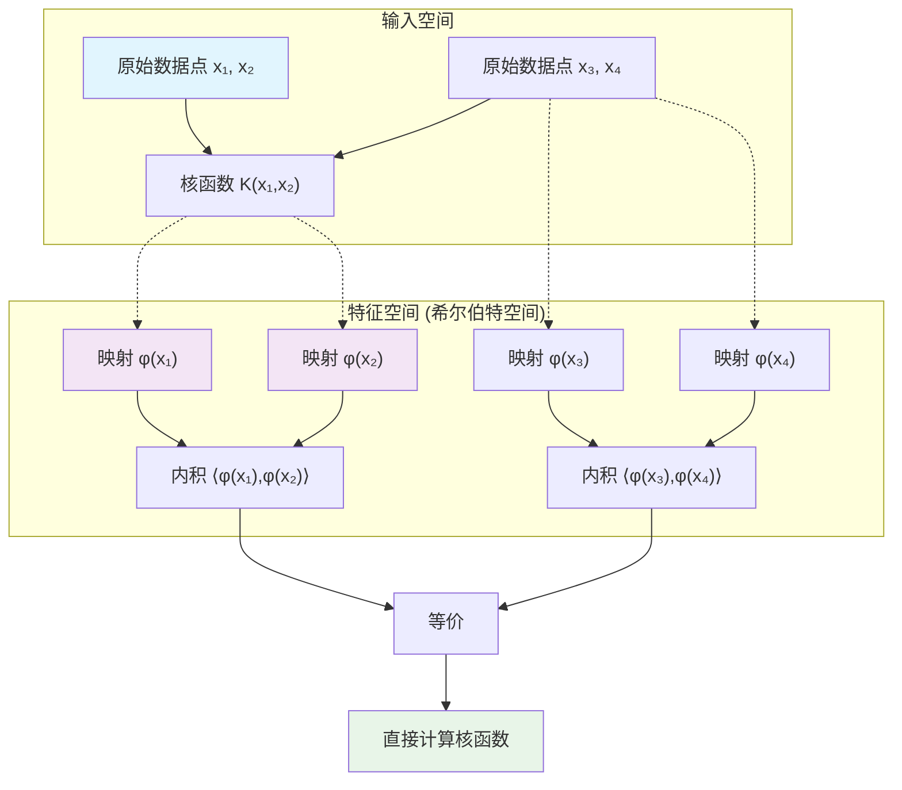
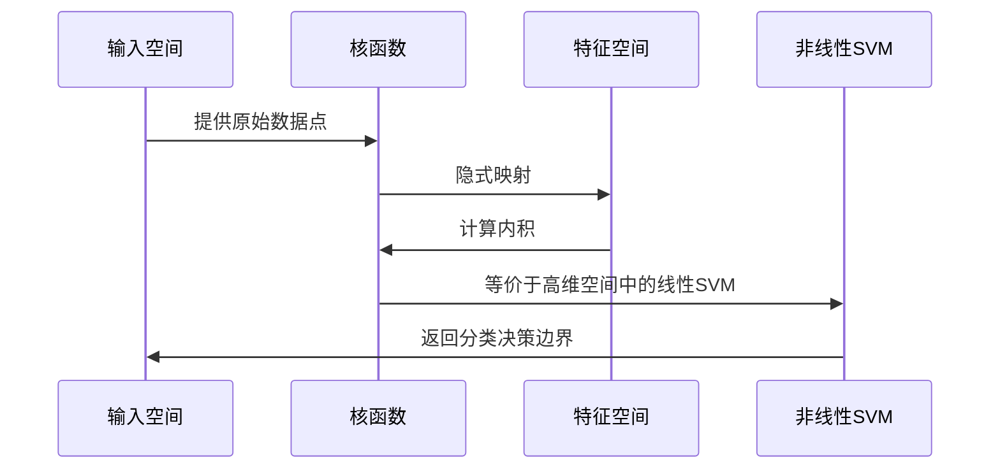
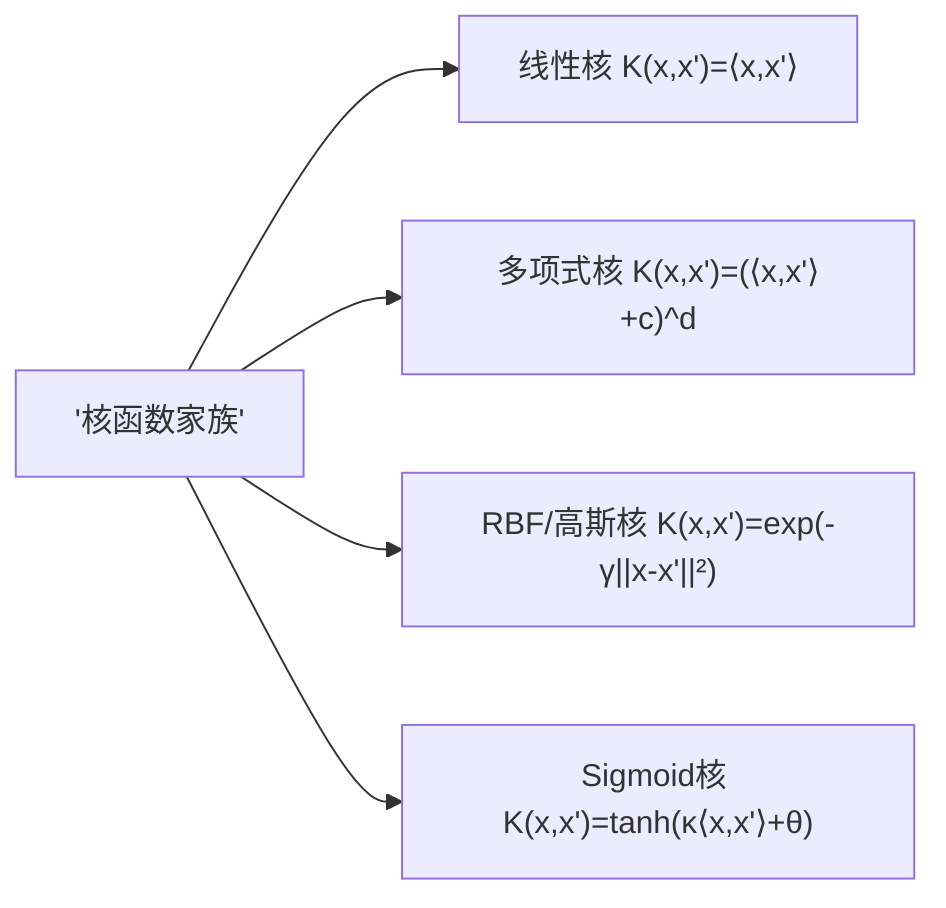
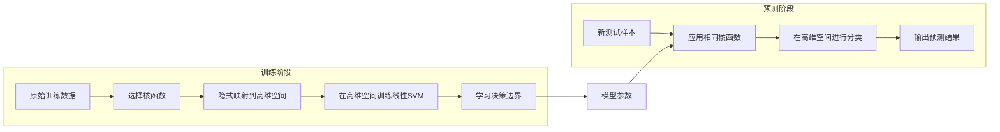

# 核技巧图解

## 什么是核技巧？

## 核技巧的工作原理

## 关键概念解释

| 概念 | 定义 | 说明 |
|------|------|------|
| 输入空间 | 欧式空间或离散集合 | 原始数据所在的空间 |
| 特征空间 | 希尔伯特空间 | 高维映射后的空间 |
| 核函数 | K(xᵢ, xⱼ) = ⟨φ(xᵢ), φ(xⱼ)⟩ | 避免显式映射的计算技巧 |
| 映射函数 | φ(·) | 将输入映射到高维空间 |

## 常见核函数

## 实际应用流程

