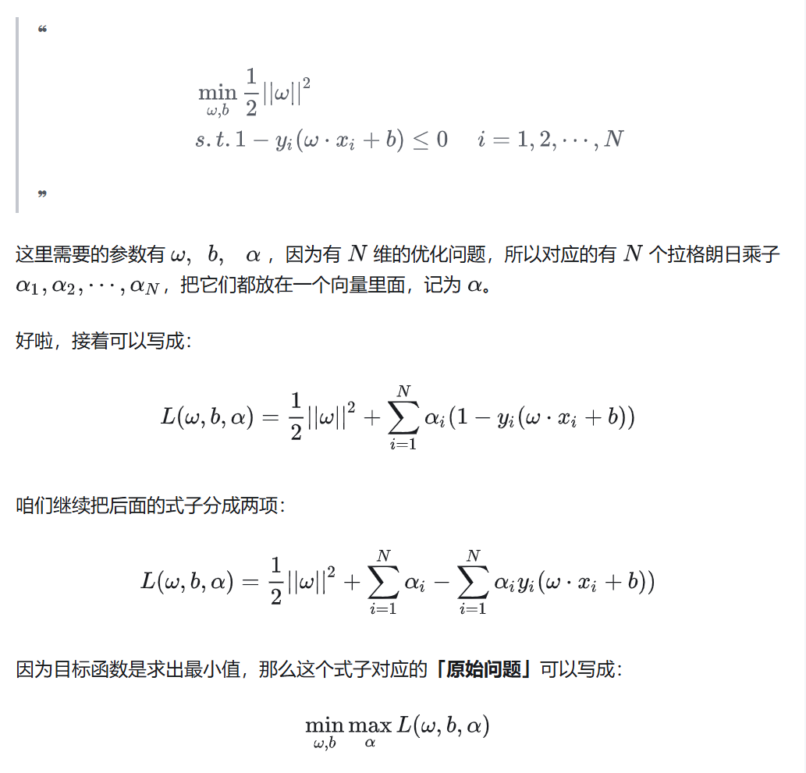

# 怎么得出的对偶理论


你问的是：**“怎么得出的原始问题形式”**，即为什么最终写成：

> **min max L(ω, b, α)**

这个形式是**拉格朗日对偶理论中“原始问题”（Primal Problem）的标准表达方式**，它来源于将带约束的优化问题转化为无约束的拉格朗日函数后，通过“先最大化拉格朗日乘子、再最小化原变量”的方式来等价还原原始约束优化问题。

---

## 📌 一、回顾原始优化问题

我们从最开始的 SVM 原始问题出发：

$$
\min_{ω,b} ~ \frac{1}{2} ||ω||^2 \\
s.t. ~~~  1 - y_i(ω \cdot x_i + b) \le 0,   i = 1,2,...,N
$$

这是一个**带不等式约束的凸优化问题**。


## 📌 二、引入拉格朗日乘子构造拉格朗日函数

为了处理约束，我们引入拉格朗日乘子 $α_i ≥ 0$（因为是不等式约束），构造拉格朗日函数：
$$
L(ω, b, α) = \frac{1}{2}||ω||^2 + \sum_{i=1}^N α_i [1 - y_i(ω \cdot x_i + b)]
$$

注意：这里 $α_i$ 是**非负的**，这是由 KKT 条件决定的（不等式约束对应的乘子必须 ≥ 0）。

## 📌 三、为什么原始问题可以写成 min max L？

关键在于理解：

> **原始问题的目标是最小化目标函数，同时满足所有约束。**

而拉格朗日函数的设计巧妙之处在于：
- 如果某个约束被违反（即 $1 - y_i(ω \cdot x_i + b) > 0$），那么我们可以让对应的 $α_i → +∞$，使得 $L → +∞$。
- 如果所有约束都满足（即 $1 - y_i(ω \cdot x_i + b) \le 0$），由于 $α_i \ge 0$，那么 $α_i [1 - y_i(...)] \le 0$，所以 $L \le \frac{1}{2}||ω||^2$。
- 特别地，当约束严格满足时，最优解处通常有 $α_i = 0$（互补松弛性），此时 $L = \frac{1}{2}||ω||^2$。

因此，对于固定的 ω, b：

$$
\max_{\alpha ≥ 0} L(ω, b, α) \\
1)=  \frac{1}{2}||ω||^2,           \text{如果所有约束满足} \\
2)=  +∞,                    \text{如果有任何一个约束被违反}
$$

也就是说：

- $\max_{\alpha ≥ 0} L(ω, b, α)$ 是一个“惩罚函数”——只有在可行域内才等于原目标函数，否则为无穷大

于是，如果我们再对这个结果关于 ω, b 求最小值：

```
min_{ω,b} [ max_{α≥0} L(ω, b, α) ]
```

这就等价于：

> 在所有满足约束的 (ω, b) 中，找到使 (1/2)||ω||² 最小的那个 —— 这正是原始问题！

---

## ✅ 所以，“原始问题”的标准形式就是：

> **min_{ω,b} max_{α≥0} L(ω, b, α)**

这叫做**原始问题的拉格朗日形式**或**极小极大形式**。

---

## 🔁 对比：对偶问题

与之相对的是**对偶问题**：

> **max_{α≥0} min_{ω,b} L(ω, b, α)**

这是交换了 min 和 max 的顺序，在满足 Slater 条件（如 SVM 中通常是满足的）下，原始问题和对偶问题的最优值相等（强对偶成立）。

---

## 🧠 总结一句话：

> **“min max L” 是通过拉格朗日函数把约束“编码”进目标函数的一种方式：只有当约束满足时，max_α L 才有限且等于原目标；否则趋于无穷，从而迫使优化过程只在可行域内搜索。**

这就是为什么原始问题可以写成：

> **min_{ω,b} max_{α} L(ω, b, α)**

（注：虽然严格来说应写 α ≥ 0，但在上下文中常省略，默认 α 是非负的）

---

✅ 希望这个解释帮你彻底理解了“原始问题形式”的由来！如果有兴趣，我还可以继续讲如何推导对偶问题 😊


